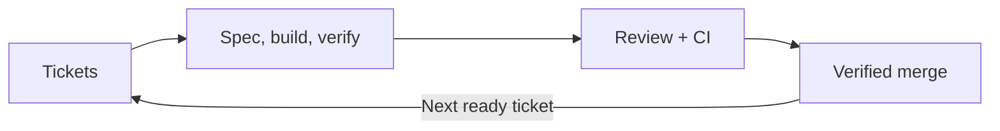
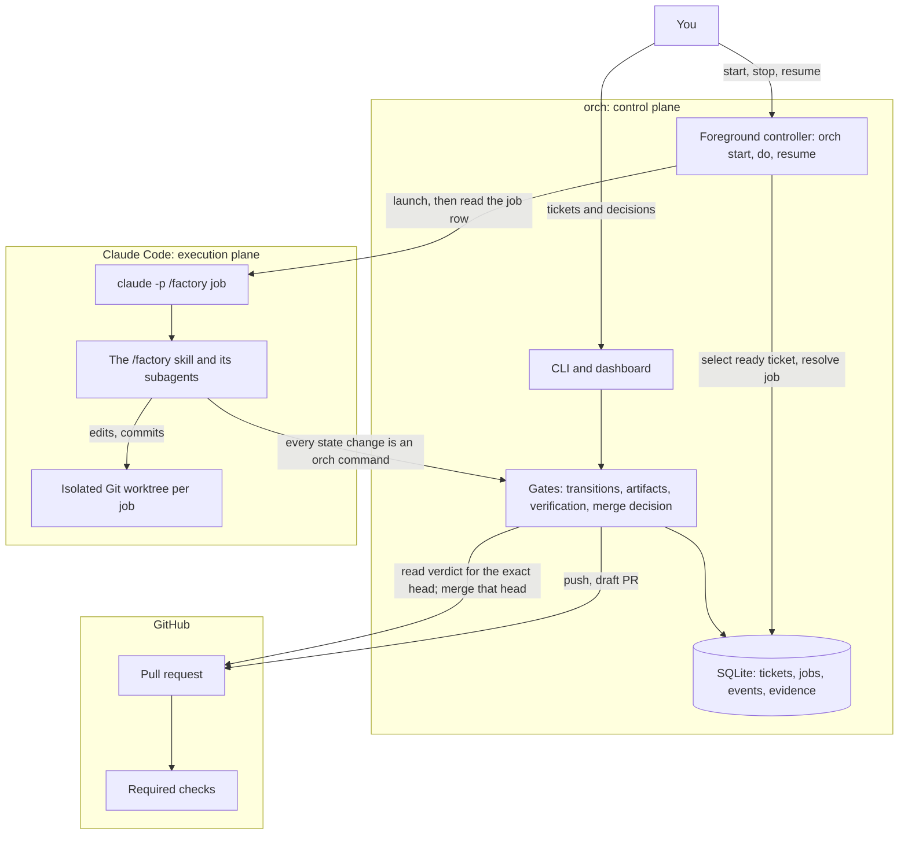
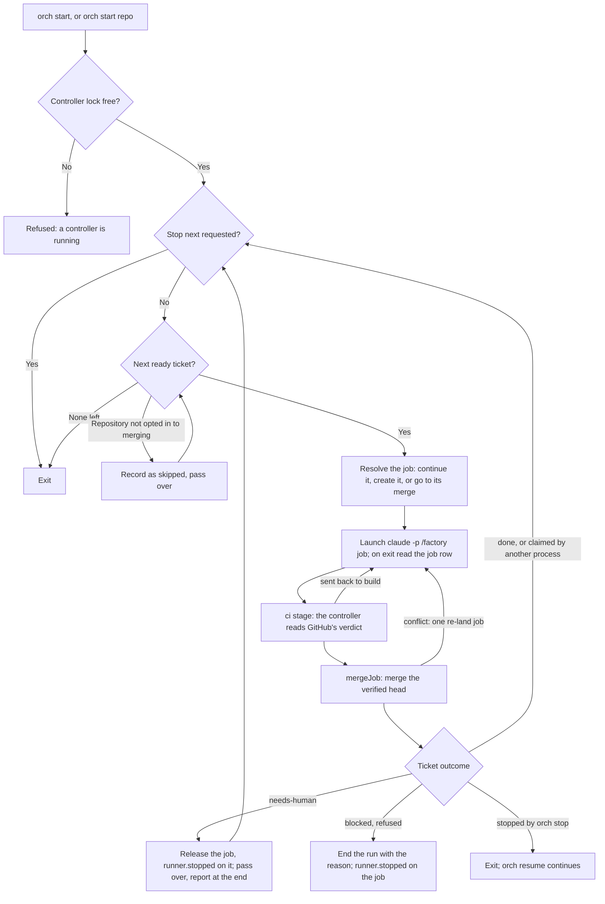

# orch

**A local software factory for Claude Code.** Unattended, not unchecked: `orch` works the one
ticket queue of all your repositories without supervision, has independent Claude Code sessions
specify each ticket, build it in its own Git worktree, and review it, and merges only the changes
it has proven. What stops a wrong merge:

- **Stages enforced in code.** A one-shot CLI over one SQLite database decides which of eight
  stages, `spec` to `completed`, is legal next and validates every artifact; Claude Code changes
  state only through it ([docs/workflow.md](docs/workflow.md#the-ticket-lifecycle-end-to-end)).
- **Evidence `orch` executed.** It runs the repository's own committed checks itself and pins the
  result to the commit; every gate recomputes it instead of taking an agent's word.
- **An exact-head merge.** GitHub's required checks must pass on the exact PR head; `orch` merges
  that head only, and a second read of GitHub confirms it.

It builds itself: as of 2026-11-25, `orch` had merged 117 of this repository's PRs from its
`factory/` branches, and 120 of its tickets were done.



## Who it's for, and who it isn't

For a developer with several repositories, a backlog, and a Claude plan, but no time to review
every agent PR. Choose something else for parallel throughput (`orch` works one ticket at a time),
live steering (it never messages a running session), a team tracker (the queue is local and
single-user), other agents or hosts (Claude Code and GitHub only), a weak test suite (the evidence
is only as good as the checks), or large, ambiguous work (tickets must be small enough to specify).

| category                   | who decides the steps   | who runs the checks        | what stops a wrong merge                  | what runs unattended            |
| -------------------------- | ----------------------- | -------------------------- | ----------------------------------------- | ------------------------------- |
| Cloud, tracker, OSS agents | the agent               | the agent, then CI         | branch protection and human review        | one task, up to a PR            |
| Claude Code, worktree GUIs | the person and agent    | the agent                  | human review                              | the sessions a person watches   |
| Spec frameworks            | a written procedure     | the agent                  | human review                              | one feature's steps             |
| Review bots                | (comment only)          | an LLM reading the diff    | a person acting on comments               | a review per PR                 |
| Merge queues               | (merge only)            | CI, on the merged result   | the queue's test of the merged result     | merging approved PRs            |
| Gas Town                   | agents, from procedures | the merging agent          | the merging agent's judgement             | a daemon and supervising agents |
| AO                         | an orchestrating agent  | GitHub                     | a person asks for each merge              | many sessions, under a daemon   |
| `orch`                     | code                    | `orch`, pinned to a commit | code: exact-head merge, verified evidence | a backlog, drained to merged    |

Dated, sourced, and per category: [docs/landscape.md](docs/landscape.md).

## Key capabilities

- **Global ticket management.** One queue across every repository on the machine: priorities,
  types, areas, efforts, dependencies that may cross repositories, history, and computed
  readiness ([docs/tickets.md](docs/tickets.md)).
- **Autonomous ticket execution.** `orch start` works the ready queue in the foreground, one
  ticket at a time, continuing a stranded in-progress ticket (its job released) before a new
  one, launching `claude -p "/factory <job>"` for each job.
- **Independent review and rework.** A spec challenger, a simplifier, three always-on reviewers
  (security, correctness, code quality) plus three UI reviewers when the diff renders UI, and an
  approver; findings send the job back to build, within a budget.
- **CI verification and repair.** GitHub's verdict for the PR head is read and acted on: one
  re-run per head, then a bounded repair cycle through build, review, and approval.
- **Recovery and human escalation.** State lives in the database, artifacts, and Git, never in a
  conversation; every retry is bounded; a decision only a person can make is a `needs-human`
  stage the job cannot leave by itself ([docs/operations.md](docs/operations.md)).
- **Dashboard and CLI.** `orch ui` shows jobs, tickets, the controller's status, and the human
  decisions; the CLI does everything else ([docs/dashboard.md](docs/dashboard.md)).

## How it fits together

`orch` is the control plane; Claude Code is the execution plane; GitHub holds the pull request
and its checks.



The controller never performs a stage: it launches `/factory`, and the skill runs the stages by
calling `orch`, whose gates decide. SQLite is authoritative for tickets, jobs, events, artifacts,
verification runs, and leases; GitHub for the PR, its checks, and the merge; small runner files
for the controller's own lock and stop requests. The full authority table and architecture are in
[docs/overview.md](docs/overview.md).

## The autonomous loop



What the code guarantees (`drive` and `runQueue` in `src/ops/run.ts`):

- one controller per installation, enforced by a lock; a second `orch start` is refused;
- one ticket at a time;
- a global queue across repositories, or one repository with `orch start repo`;
- dependencies decide readiness: the queue is `orch ticket ready`;
- in queue mode a ticket whose repository lacks the merge opt-in is passed over and recorded as
  skipped, never started, and the queue continues; it stays skipped for the whole of that
  session, `orch resume` included, so after enabling one, start a new session;
- `orch do <ticket>` refuses to start a new job without the opt-in, but continues an existing job,
  whose merge is then blocked with `not-authorized`;
- a ticket outcome of `done` continues to the next ready ticket; in queue mode every other
  outcome that concerns only its ticket (`needs-human`, `claimed`, and any `blocked` or `refused`,
  for example a merge that left a checklist box open) releases the job, passes the ticket over for
  the rest of the session, and continues (tickets that depend on it stay unready; the
  end-of-session summary lists it with its next step and the exit status is 1); only an outcome
  that would hit every ticket ends the run with that reason: claude cannot start, GitHub cannot
  be read or answers nothing, or refuses the merge call, or a rebuilt `orch` or invalid
  `factory.json` (both resumable) (`RUN_ENDING_CODES` in `src/core/workflow.ts`); `stopped` ends it as a resumable stop; `orch stop next` ends it before
  the next ticket, and so does an empty ready queue;
- `orch do <ticket>` runs that one ticket and exits, whatever its outcome;
- it is not a daemon: nothing keeps running after the command exits.

## Install

Requirements: Node.js 24+, Git, the GitHub CLI (`gh auth login`), Claude Code (the native
`claude` executable on PATH, signed in, for `orch start`; VS Code for interactive sessions).

```sh
git clone https://github.com/jonborchardt/orch && cd orch
npm install && npm run build && npm link   # `orch` on PATH, running dist/
orch install                               # link skills/ and agents/ into ~/.claude
orch doctor                                # Node, Git, Claude Code, gh, paths, database, links
```

Restart Claude Code afterwards (skills are read at session start). After pulling a new version,
run `npm run build` and `orch install` again; `orch doctor` reports stale agent copies.
`npm run build` records its commit in `dist/build-info.json`, and `orch status` and the dashboard
warn when the install checkout or its upstream has moved past it. The check reads local refs only:
it never fetches, pulls, or rebuilds, so it sees upstream commits only after a `git fetch`.

## Configure a repository

`orch` runs only the checks a repository has committed in `factory.json`, read from the merge
base of the job branch (code the job did not write). Onboard a repository once:

```sh
cd ~/code/my-app
orch init --from-package-json      # proposes npm run check / build from package.json; or --command "test=cargo test"
cat factory.json                   # executables on PATH, argument arrays, no shell strings
git add factory.json && git commit -m "Add factory verification policy" && git push
orch init --check                  # READY, or exactly what is missing; plus a readiness grade A-D
orch factory config merge enable --repo ~/code/my-app   # let orch merge this repository's verified PRs (shows the grade)
```

The readiness grade counts four facts: the policy has a required check that runs tests (its id or
arguments contain `test` or `check`), and, read with `gh` when origin is on github.com, the base
branch requires status checks, requires branches to be up to date (or uses a merge queue), and is
protected. A = 4, B = 3, C = 2, D = 0 or 1; a fact GitHub would not answer is unknown and never
counts. `orch factory config merge` and the dashboard's Merge dialog show the same grade. It is
advice only: it never changes an exit code, a gate, or a merge.

```json
{
  "verification": {
    "commands": [
      { "id": "check", "command": "npm", "args": ["run", "check"] },
      { "id": "build", "command": "npm", "args": ["run", "build"] }
    ]
  }
}
```

A job that edits `factory.json` changes nothing by itself: the baseline policy keeps running, the
plan reports `policy.authorization: required`, and a human accepts or rejects the proposal from the
dashboard. A repository with no policy cannot pass the gates until one is committed on the base
branch. Details: [docs/workflow.md](docs/workflow.md#verification-evidence).

A repository whose GitHub CI runs the full suite can add `"authority": "ci"` to `verification` and
list only fast checks (typecheck, lint, format, build): the commit then goes to the draft PR and must
pass CI before review and approval. The default, `local`, keeps today's order and suits a repository
without CI. Details: [docs/workflow.md](docs/workflow.md#verification-authority). A PR that changes
`.github/workflows/` is merged only by a human's click on the dashboard.

The merge opt-in is off by default, per repository, and kept in your own `<config>/factory.json`,
never in a repository. Model overrides, `maxRounds`, `maxCiRepairs`, and `runnerClaudeArgs` go in
the same file (`orch factory config` prints it). `models.<role>` is a model (`opus`, `sonnet`,
`haiku`, `fable`, `inherit`) or a pool, a non-empty array of distinct ones such as
`{"builder": ["opus", "fable"]}`: orch draws one model per role when it creates a job, keeps it for
the whole job, and records it on the job and on every review. You maintain the pools; orch never
prunes them. The controller's Claude session gets
`--permission-mode auto` plus an allow-list for `orch`, `git`, `npm`, `npx`, `node`, and `cd`,
never a permission bypass. A repository whose builder needs other tools (`pnpm`, `cargo`,
`pytest`) needs them in `"runnerClaudeArgs"`, which replaces the default list. A Windows
`claude.cmd` shim is refused, because the prompt cannot be passed through `cmd.exe` safely.
Details and an example: [docs/workflow.md](docs/workflow.md#claude-code-configuration).

## Common operations

```sh
# tickets
orch ticket add "Fix verification race" --priority P1 --area core   # for the cwd's repository
orch ticket dep add 85 62             # 0085 waits until 0062 is done
orch ticket ready                     # what can be worked on now, in order, every repository
orch ticket blocked                   # what cannot, and why
orch ticket show 85

# the controller
orch start                # every repository's ready tickets, best first, one at a time
orch start repo           # only the repository containing the current directory
orch do 85                # one ticket: start its job, continue it, or merge it
orch do 85 --fast         # the same, but a new job is a fast job (see below)
orch status               # controller, ticket, job, what it waits on, what happens next
orch stop next            # finish the current ticket, start no other, exit
orch stop                 # end the current session now; the job is kept, never cancelled
orch resume               # continue an interrupted session: same scope, ticket, job, stop request

# jobs
orch factory list                     # every job, every repository
orch factory status job-1a2b3c4d      # where it is, what blocks it, next step, numbered commands
orch job events job-1a2b3c4d          # the audit log, runner.session and runner.stopped included
orch job merge job-1a2b3c4d           # where opted in: merge the verified PR and close the ticket
orch ui                               # dashboard at http://127.0.0.1:4777/

# backup (safe while orch runs; restore only into an empty, inactive data directory)
orch backup create D:\backups\orch-2026-11-22.tar.gz
orch backup restore D:\backups\orch-2026-11-22.tar.gz --data-dir C:\tmp\orch-test   # test restore
ORCH_HOME=C:\tmp\orch-test orch ticket list                                         # inspect it
```

A job can also run without the controller. In a Claude Code session in the repository,
`/factory Add CSV export` starts a job and `/factory job-1a2b3c4d` continues one; from VS Code's
Agents window, `/factory dispatch ...` starts several jobs in independent sessions. To run a ticket
by hand, start its job with `orch factory start ... --ticket <id>` (or take one `orch do` created
or stopped), continue it with `/factory <job>` in a session you can talk to, and once it is
`completed` merge with `orch do <ticket>` or `orch job merge <job>`; `orch do` is the autonomous
way. How each works, and what happens at every step of a
controller run, is in [docs/operations.md](docs/operations.md). A job that stops records why on
itself (`runner.stopped`, next to a `runner.session` event per Claude session); decide a job that
needs a person on the dashboard, then `orch do <ticket>` continues the same job.

For a small, low-risk ticket you choose, `orch do <ticket> --fast` creates a fast job: one agent
builds, verifies, and writes `build.md`, then PR, CI, and merge as usual, with no spec, simplify,
review, or approval. The gates still hold (verification, `build.md`'s HEAD binds delivery, CI,
merge rules), and a fast build that touches `factory.json`, CI, test configuration, dependencies,
or disables a test is refused and escalates. Nothing classifies tickets for you, and a fast job
never turns into a full one: cancel it instead, which reopens the ticket for a new full job
([docs/workflow.md](docs/workflow.md#fast-jobs)).

Optional email reports of every job change and of each controller session's end: [docs/operations.md](docs/operations.md#email-reports).

## What `orch` automates and enforces

- Job state, leases, tokens, and the audit log; one owner per job; stale commands fail with exit 4.
- Ticket readiness and claiming: a job is created for a ticket only in the transaction that marks
  the ticket in progress, and a unique index allows one unfinished job per ticket.
- Artifact validation (location, structure, marker line) and registration pinned to the worktree
  HEAD; replacing registered evidence needs `--replace` and is logged.
- Verification: the committed policy, run in the clean worktree, logs saved per check; its validity
  recomputed from HEAD, tree, and policy fingerprint at every gate.
- Review rounds: security, correctness, and code-quality must all report, against the commit
  `build.md` describes; reviewers are read-only (fingerprint-checked); blocking findings or
  `CHANGES` return the job to build, until a rejection in round `maxRounds` escalates. Base-integration
  rework, CI repairs, and a human's resume to build, simplify, or review raise `maxRounds` by one
  instead of using it up.
- Delivery: only an approved commit (plus clean base merges) is pushed or counts as delivered; the
  draft PR is created or reused, never duplicated; the job completes only inside `orch gh ci` after
  GitHub reports passing required checks for that exact head on the job's own PR, and `orch` then
  marks the PR ready; failed checks get one re-run, then a repair cycle through build, review, and
  approval (bounded by `maxCiRepairs`).
- Merging, where you opted in: `gh pr merge --merge --match-head-commit <ciHead>`, confirmed by a
  second read of GitHub, and only when GitHub's compare says `ciHead` contains the base's current
  tip; a base that moved after CI passed is merged into the branch and the job reopened into `pr`
  (outcome `base-moved`; at most twice per job, then `base-moving` waits for a person; a job that
  cannot be reopened is `reopen-refused`); a conflict becomes one re-land job; the ticket closes
  only on a verified merge with no unchecked checklist item.
- Sensitive changes (tests, CI, dependencies, the policy, and files the policy's commands run
  directly) are labelled and must be named in the consolidated review and the PR body. Labelling is
  not prevention: the policy fixes which commands run, not what the job's scripts do.
- Isolation: worktrees outside every checkout (under the data directory for jobs `orch` starts;
  VS Code's `<repo>.worktrees/<slug>` beside the repository for dispatched jobs); two jobs never
  share a worktree or branch; the primary checkout is never written to.

## What still needs a human

- Merging a repository you have not opted in (on GitHub, or Merge in the dashboard). Marking a PR
  ready when `gh pr ready` failed (reported, not retried; Refresh PR records it afterwards). Fixing
  GitHub Actions itself (billing, runners, a workflow that never reports): `orch` escalates after
  one re-run.
- Accepting a verification policy a job proposed, or onboarding a repository that has none.
- Deciding on an approver's `ESCALATE`, a review round that still requests changes at the limit, a
  spent CI repair budget, a second merge conflict, a PR closed or moved outside the job.
- Restarting after a stop: `orch do <ticket>` or `orch resume` for the controller, `/factory <id>`
  in any session otherwise. The opt-in recovery worker (`orch recover start`) continues only the
  `ci` stage on its own.
- Ending a Claude process that outlived a crashed controller: `orch resume` and `orch stop` refuse
  while the process at the recorded PID started when the child did (or its start time cannot be
  read), and never signal or adopt it. The refusal says how to inspect the PID; end it yourself
  and rerun, or use `orch resume --force` only if it is another program. A PID reused by another
  program is recognised by its start time and does not block.
- Anything cooperative: subagents staying inside the worktree, reviewers reading the logs they are
  given, the parent recording the child session before the child claims the job. These are stated in
  prose and verified after the fact (fingerprints, dirty-file lists), not prevented.

## Limitations

Each limit is the price of a guarantee ([why](docs/operations.md#intentional-limitations)): one
ticket and one headless `claude -p` session at a time, never steered, keeps evidence pinned to a
single head; no daemon means no hidden state outlives a command; bounded retries and no adoption of
surviving processes make every stop explicit; GitHub only, through `gh`, gives one source for
checks and the merge (one automatic re-run per commit, so a run Actions never started costs a repair
cycle); a loopback-only, single-user dashboard needs no login and cannot start the controller.

Still open: the base can move between the compare read and `gh pr merge` (`--match-head-commit`
pins only the head), and no merge queue tests the merged result; GitHub's "require branches to be
up to date" rule closes that window. GitHub's free plan hides a private repository's required
checks (HTTP 403), so every reported check must pass there. Ownership is advisory on the
filesystem: a write outside the worktree is not counted as progress, but it is not prevented.
Dispatch outside VS Code's Agents window prints the command for a human. No cost accounting: token
counts come from Claude Code's undocumented transcript format (the dashboard's Usage section).

## Where things live

| Purpose   | Windows                                                                     | macOS                                | Linux                   |
| --------- | --------------------------------------------------------------------------- | ------------------------------------ | ----------------------- |
| config    | `%APPDATA%\orch`                                                            | `~/Library/Application Support/orch` | `$XDG_CONFIG_HOME/orch` |
| data      | `%LOCALAPPDATA%\orch`                                                       | same as config                       | `$XDG_DATA_HOME/orch`   |
| database  | `<data>\orch.sqlite`                                                        | `<data>/orch.sqlite`                 | `<data>/orch.sqlite`    |
| artifacts | `<data>\jobs\<id>\artifacts\`                                               | `<data>/jobs/<id>/artifacts/`        | same                    |
| worktrees | `<data>\worktrees\<repo slug>\<id>`                                         | `<data>/worktrees/<repo slug>/<id>`  | same                    |
| tickets   | the database; `<data>\tickets\<id>\assets\`                                 | `<data>/tickets/<id>/assets/`        | same                    |
| runner    | `<data>\runner-lock\`, `runner.json`, `runner.stop-next`, `runner.stop-now` | the same under `<data>/`             | same                    |

`ORCH_HOME=<dir>` redirects all of it (tests and side-by-side campaigns use this).

`orch backup create <file>` archives the database, artifacts, and ticket assets into one
`.tar.gz`; `orch backup restore <file> [--data-dir <dir>]` puts them back into an empty data
directory. Worktrees, repositories, runner state, logs, and configuration are not included.
Details: [docs/operations.md](docs/operations.md#backup-and-restore).

## Documentation

- `orch <command> --help` for every command and option.
- [docs/overview.md](docs/overview.md): the architecture: control and execution planes, sources of
  truth, tickets and jobs, ownership, verification boundaries, recovery, and how `orch` compares
  with Beads, agent-orchestrator, and Gas Town.
- [docs/landscape.md](docs/landscape.md): where `orch` sits among AI coding tools, by category,
  each claim dated and marked demonstrated or claimed.
- [docs/workflow.md](docs/workflow.md): the ticket lifecycle end to end, stages, transitions,
  artifacts, events, worktrees, verification evidence, CI reconciliation, merging, the controller,
  ownership.
- [docs/operations.md](docs/operations.md): operating `orch`, stop and resume, diagnosing
  blocked tickets, needs-human, recovery budgets, limitations, metrics, backup and restore, email
  reports.
- [docs/tickets.md](docs/tickets.md): the ticket queue, its CLI and HTTP API.
- [docs/dashboard.md](docs/dashboard.md): the dashboard's views, actions, and security model.
- [docs/development.md](docs/development.md): stack, layout, build, tests, migrations, install
  mechanics, Windows notes, CLI reference. `CLAUDE.md` has the rules for changing the code.
- [docs/decisions/](docs/decisions/): one file per architectural decision.
- [docs/session-launch.md](docs/session-launch.md): what VS Code can and cannot do about
  independent sessions.

## License

MIT. See [LICENSE](LICENSE).
