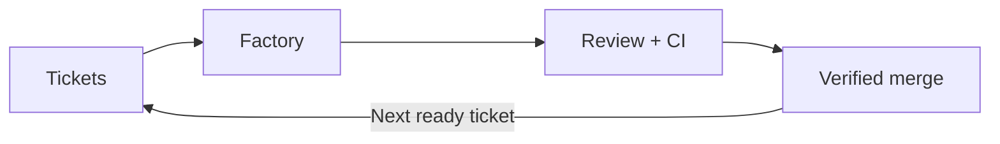
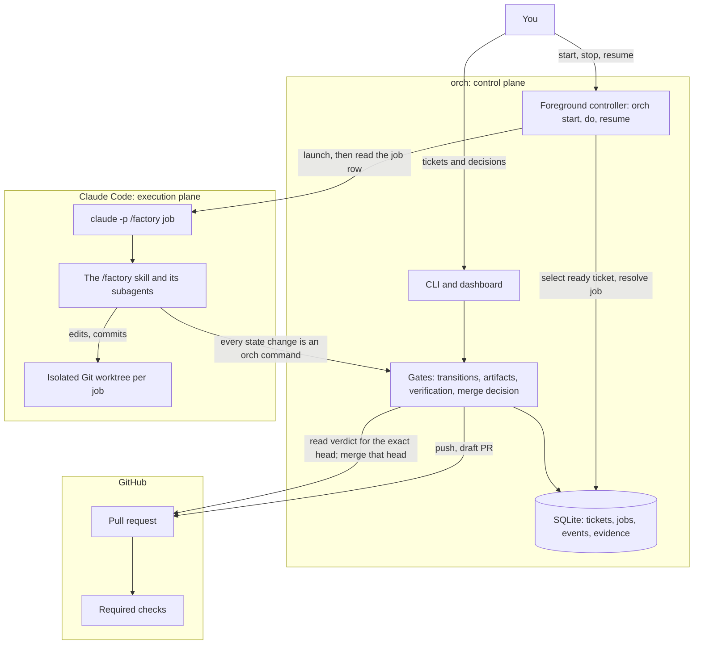
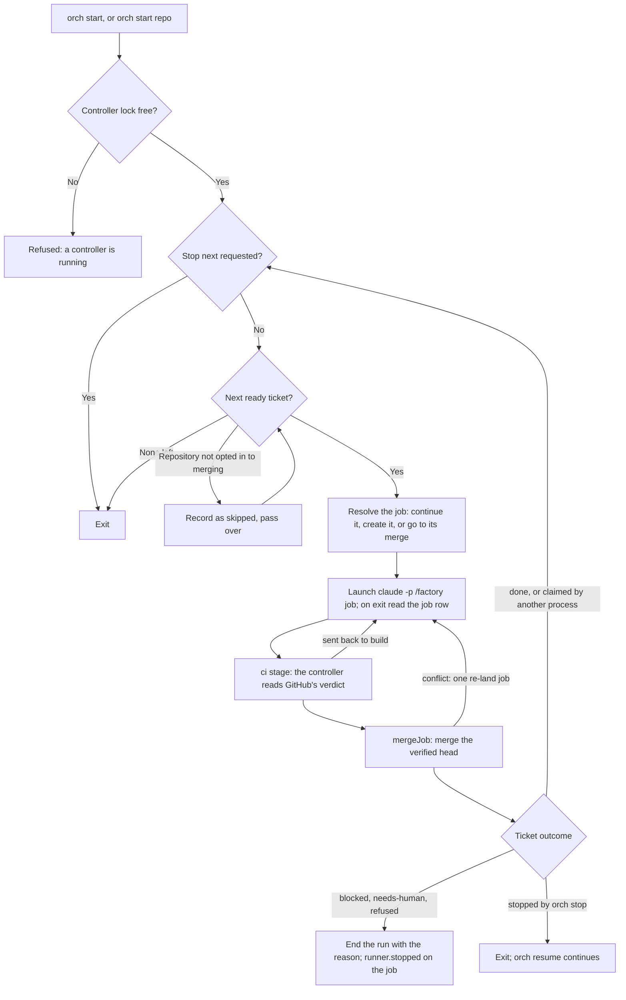

# agent-orchestrator (`orch`)

`orch` is a local software factory for Claude Code. You keep one ticket queue for all your
repositories; `orch` takes the best ready ticket, has an independent Claude Code session specify
it, build it in its own Git worktree, run the repository's own checks, and get it reviewed by
specialised subagents, then waits for GitHub's required checks on the exact pull-request head,
merges that head, closes the ticket, and takes the next one.

It exists because one agent writing code is not evidence that the code is right. `orch` is the
small deterministic part that makes the work checkable: a one-shot CLI over one SQLite database
that decides which step is legal next, validates every artifact, runs the verification itself,
and records evidence pinned to commits. Claude Code does the creative work and changes state only
through that CLI.



## Key capabilities

- **Global ticket management.** One queue across every repository on the machine: priorities,
  types, areas, efforts, dependencies that may cross repositories, history, and computed
  readiness ([docs/tickets.md](docs/tickets.md)).
- **Autonomous ticket execution.** `orch start` works the ready queue in the foreground, one
  ticket at a time, launching `claude -p "/factory <job>"` for each job.
- **A multi-stage engineering workflow.** Eight stages, `spec` to `completed`, each gated by
  TypeScript on a validated artifact and a verification run for the exact commit
  ([docs/workflow.md](docs/workflow.md#the-ticket-lifecycle-end-to-end)).
- **Independent review and rework.** A spec challenger, a simplifier, three always-on reviewers
  (security, correctness, code quality) plus four UI reviewers when the diff renders UI, and an
  approver; findings send the job back to build, within a budget.
- **CI verification and repair.** GitHub's verdict for the PR head is read and acted on: one
  re-run per head, then a bounded repair cycle through build, review, and approval.
- **Verified PR integration.** A merge commit at the CI-verified head only, confirmed by reading
  GitHub again; the ticket closes in the same transaction, and only when nothing is left on it.
- **Recovery and human escalation.** State lives in the database, artifacts, and Git, never in a
  conversation; every retry is bounded; a decision only a person can make is a `needs-human`
  stage the job cannot leave by itself ([docs/operations.md](docs/operations.md)).
- **Dashboard and CLI.** `orch ui` shows jobs, tickets, the controller's status, and the human
  decisions; the CLI does everything else ([docs/dashboard.md](docs/dashboard.md)).

## How it fits together

`orch` is the control plane; Claude Code is the execution plane; GitHub holds the pull request
and its checks.



The controller never performs a stage: it launches `/factory`, and the skill runs the stages by
calling `orch`, whose gates decide. SQLite is authoritative for tickets, jobs, events, artifacts,
verification runs, and leases; GitHub for the PR, its checks, and the merge; small runner files
for the controller's own lock and stop requests. The full authority table and architecture are in
[docs/overview.md](docs/overview.md).

## The autonomous loop



What the code guarantees (`drive` and `runQueue` in `src/ops/run.ts`):

- one controller per installation, enforced by a lock; a second `orch start` is refused;
- one ticket at a time;
- a global queue across repositories, or one repository with `orch start repo`;
- dependencies decide readiness: the queue is `orch ticket ready`;
- in queue mode a ticket whose repository lacks the merge opt-in is passed over and recorded as
  skipped, never started, and the queue continues; it stays skipped for the whole of that
  session, `orch resume` included, so after enabling one, start a new session;
- `orch do <ticket>` refuses to start a new job without the opt-in, but continues an existing job,
  whose merge is then blocked with `not-authorized`;
- a ticket outcome of `done` continues to the next ready ticket, and so does `claimed` (another
  process created its job meanwhile; that ticket is passed over); `blocked`, `needs-human`, or
  `refused` ends the run with that reason; `stopped` ends it as a resumable stop; `orch stop next`
  ends it before the next ticket, and so does an empty ready queue;
- `orch do <ticket>` runs that one ticket and exits, whatever its outcome;
- it is not a daemon: nothing keeps running after the command exits.

## Install

Requirements: Node.js 24+, Git, the GitHub CLI (`gh auth login`), Claude Code (the native
`claude` executable on PATH, signed in, for `orch start`; VS Code for interactive sessions).

```sh
git clone https://github.com/jonborchardt/orch && cd orch
npm install && npm run build && npm link   # `orch` on PATH, running dist/
orch install                               # link skills/ and agents/ into ~/.claude
orch doctor                                # Node, Git, Claude Code, gh, paths, database, links
```

Restart Claude Code afterwards (skills are read at session start). After pulling a new version,
run `npm run build` and `orch install` again; `orch doctor` reports stale agent copies.

## Configure a repository

The factory runs only the checks a repository has committed in `factory.json`, read from the merge
base of the job branch (code the job did not write). Onboard a repository once:

```sh
cd ~/code/my-app
orch init --from-package-json      # proposes npm run check / build from package.json; or --command "test=cargo test"
cat factory.json                   # executables on PATH, argument arrays, no shell strings
git add factory.json && git commit -m "Add factory verification policy" && git push
orch init --check                  # READY, or exactly what is missing
orch factory config merge enable --repo ~/code/my-app   # let orch merge this repository's verified PRs
```

```json
{
  "verification": {
    "commands": [
      { "id": "check", "command": "npm", "args": ["run", "check"] },
      { "id": "build", "command": "npm", "args": ["run", "build"] }
    ]
  }
}
```

A job that edits `factory.json` changes nothing by itself: the baseline policy keeps running, the
plan reports `policy.authorization: required`, and a human accepts or rejects the proposal from the
dashboard. A repository with no policy cannot pass the gates until one is committed on the base
branch. Details: [docs/workflow.md](docs/workflow.md#verification-evidence).

The merge opt-in is off by default, per repository, and kept in your own `<config>/factory.json`,
never in a repository. Model overrides, `maxRounds`, `maxCiRepairs`, and `runnerClaudeArgs` go in
the same file (`orch factory config` prints it). The controller's Claude session gets
`--permission-mode auto` plus an allow-list for `orch`, `git`, `npm`, `npx`, `node`, and `cd`,
never a permission bypass. A repository whose builder needs other tools (`pnpm`, `cargo`,
`pytest`) needs them in `"runnerClaudeArgs"`, which replaces the default list. A Windows
`claude.cmd` shim is refused, because the prompt cannot be passed through `cmd.exe` safely.
Details and an example: [docs/workflow.md](docs/workflow.md#claude-code-configuration).

## Common operations

```sh
# tickets
orch ticket add "Fix verification race" --priority P1 --area core   # for the cwd's repository
orch ticket dep add 85 62             # 0085 waits until 0062 is done
orch ticket ready                     # what can be worked on now, in order, every repository
orch ticket blocked                   # what cannot, and why
orch ticket show 85

# the controller
orch start                # every repository's ready tickets, best first, one at a time
orch start repo           # only the repository containing the current directory
orch do 85                # one ticket: start its job, continue it, or merge it
orch status               # controller, ticket, job, what it waits on, what happens next
orch stop next            # finish the current ticket, start no other, exit
orch stop                 # end the current session now; the job is kept, never cancelled
orch resume               # continue an interrupted session: same scope, ticket, job, stop request

# jobs
orch factory list                     # every job, every repository
orch factory status job-1a2b3c4d      # where it is, what blocks it, next step, numbered commands
orch job events job-1a2b3c4d          # the audit log, runner.session and runner.stopped included
orch job merge job-1a2b3c4d           # where opted in: merge the verified PR and close the ticket
orch ui                               # dashboard at http://127.0.0.1:4777/
```

A job can also run without the controller. In a Claude Code session in the repository,
`/factory Add CSV export` starts a job and `/factory job-1a2b3c4d` continues one; from VS Code's
Agents window, `/factory dispatch ...` starts several jobs in independent sessions; the `/dotodo`
skill runs one ticket and merges it. How each works, and what happens at every step of a
controller run, is in [docs/operations.md](docs/operations.md). A job that stops records why on
itself (`runner.stopped`, next to a `runner.session` event per Claude session); decide a job that
needs a person on the dashboard, then `orch do <ticket>` continues the same job.

Optional email reports of every job change: [docs/operations.md](docs/operations.md#email-reports).

## What `orch` automates and enforces

- Job state, leases, tokens, and the audit log; one owner per job; stale commands fail with exit 4.
- Ticket readiness and claiming: a job is created for a ticket only in the transaction that marks
  the ticket in progress, and a unique index allows one unfinished job per ticket.
- Artifact validation (location, structure, marker line) and registration pinned to the worktree
  HEAD; replacing registered evidence needs `--replace` and is logged.
- Verification: the committed policy, run in the clean worktree, logs saved per check; its validity
  recomputed from HEAD, tree, and policy fingerprint at every gate.
- Review rounds: security, correctness, and code-quality must all report, against the commit
  `build.md` describes; reviewers are read-only (fingerprint-checked); blocking findings or
  `CHANGES` return the job to build, until a rejection in round `maxRounds` escalates. Base-integration
  rework, CI repairs, and a human's resume to build, simplify, or review raise `maxRounds` by one
  instead of using it up.
- Delivery: only an approved commit (plus clean base merges) is pushed or counts as delivered; the
  draft PR is created or reused, never duplicated; the job completes only inside `orch gh ci` after
  GitHub reports passing required checks for that exact head on the job's own PR, and `orch` then
  marks the PR ready; failed checks get one re-run, then a repair cycle through build, review, and
  approval (bounded by `maxCiRepairs`).
- Merging, where you opted in: `gh pr merge --merge --match-head-commit <ciHead>`, confirmed by a
  second read of GitHub; a conflict becomes one re-land job; the ticket closes only on a verified
  merge with no unchecked checklist item.
- Sensitive changes (tests, CI, dependencies, the policy, and files the policy's commands run
  directly) are labelled and must be named in the consolidated review and the PR body. Labelling is
  not prevention: the policy fixes which commands run, not what the job's scripts do.
- Isolation: worktrees outside every checkout (under the data directory for jobs `orch` starts;
  VS Code's `<repo>.worktrees/<slug>` beside the repository for dispatched jobs); two jobs never
  share a worktree or branch; the primary checkout is never written to.

## What still needs a human

- Merging a repository you have not opted in (on GitHub, or Merge in the dashboard). Marking a PR
  ready when `gh pr ready` failed (reported, not retried; Refresh PR records it afterwards). Fixing
  GitHub Actions itself (billing, runners, a workflow that never reports): `orch` escalates after
  one re-run.
- Accepting a verification policy a job proposed, or onboarding a repository that has none.
- Deciding on an approver's `ESCALATE`, a review round that still requests changes at the limit, a
  spent CI repair budget, a second merge conflict, a PR closed or moved outside the job.
- Restarting after a stop: `orch do <ticket>` or `orch resume` for the controller, `/factory <id>`
  in any session otherwise. The opt-in recovery worker (`orch recover start`) continues only the
  `ci` stage on its own.
- Ending a Claude process that outlived a crashed controller: `orch resume` refuses while it may be
  alive and never signals or adopts it.
- Anything cooperative: subagents staying inside the worktree, reviewers reading the logs they are
  given, the parent recording the child session before the child claims the job. These are stated in
  prose and verified after the fact (fingerprints, dirty-file lists), not prevented.

## Limitations

- The controller starts and stops headless Claude Code sessions (`claude -p`), one at a time, and
  never messages or steers one. Dispatch relies on VS Code's documented `create_session`; outside
  the Agents window it prints the command for a human to run.
- GitHub only, through `gh`; checks and commit statuses; one automatic re-run per commit; a job
  that "was not started" by Actions is indistinguishable from a failed check until a human reads the
  log, so it costs one repair cycle before escalation.
- No token or cost accounting (`orch job usage` reports measured durations and configured models).
- Private repositories on GitHub's free plan hide the required-check configuration (HTTP 403), so
  every reported check must pass there.
- The dashboard is single-user and loopback-only; it has no authentication because it has no
  network exposure. It cannot start, stop, or resume the controller.
- Ownership is advisory at the filesystem level: a process pointed at the wrong directory can
  write anywhere; `orch` refuses to count such writes as progress but cannot stop them.
- The boundaries that are design choices (no daemon, one ticket at a time, bounded retries, no
  adoption of surviving processes, ...) and why: [docs/operations.md](docs/operations.md#intentional-limitations).

## Where things live

| Purpose   | Windows                                                                     | macOS                                | Linux                   |
| --------- | --------------------------------------------------------------------------- | ------------------------------------ | ----------------------- |
| config    | `%APPDATA%\orch`                                                            | `~/Library/Application Support/orch` | `$XDG_CONFIG_HOME/orch` |
| data      | `%LOCALAPPDATA%\orch`                                                       | same as config                       | `$XDG_DATA_HOME/orch`   |
| database  | `<data>\orch.sqlite`                                                        | `<data>/orch.sqlite`                 | `<data>/orch.sqlite`    |
| artifacts | `<data>\jobs\<id>\artifacts\`                                               | `<data>/jobs/<id>/artifacts/`        | same                    |
| worktrees | `<data>\worktrees\<repo slug>\<id>`                                         | `<data>/worktrees/<repo slug>/<id>`  | same                    |
| tickets   | the database; `<data>\tickets\<id>\assets\`                                 | `<data>/tickets/<id>/assets/`        | same                    |
| runner    | `<data>\runner-lock\`, `runner.json`, `runner.stop-next`, `runner.stop-now` | the same under `<data>/`             | same                    |

`ORCH_HOME=<dir>` redirects all of it (tests and side-by-side campaigns use this).

## Documentation

- `orch <command> --help` for every command and option.
- [docs/overview.md](docs/overview.md): the architecture: control and execution planes, sources of
  truth, tickets and jobs, ownership, verification boundaries, recovery, and how `orch` compares
  with Beads, agent-orchestrator, and Gas Town.
- [docs/workflow.md](docs/workflow.md): the ticket lifecycle end to end, stages, transitions,
  artifacts, events, worktrees, verification evidence, CI reconciliation, merging, the controller,
  ownership.
- [docs/operations.md](docs/operations.md): operating the factory, stop and resume, diagnosing
  blocked tickets, needs-human, recovery budgets, limitations, metrics, email reports.
- [docs/tickets.md](docs/tickets.md): the ticket queue, its CLI and HTTP API, and the import.
- [docs/dashboard.md](docs/dashboard.md): the dashboard's views, actions, and security model.
- [docs/development.md](docs/development.md): stack, layout, build, tests, migrations, install
  mechanics, Windows notes, CLI reference. `CLAUDE.md` has the rules for changing the code.
- [docs/decisions/](docs/decisions/): one file per architectural decision.
- [docs/session-launch.md](docs/session-launch.md): what VS Code can and cannot do about
  independent sessions.

## License

MIT. See [LICENSE](LICENSE).
