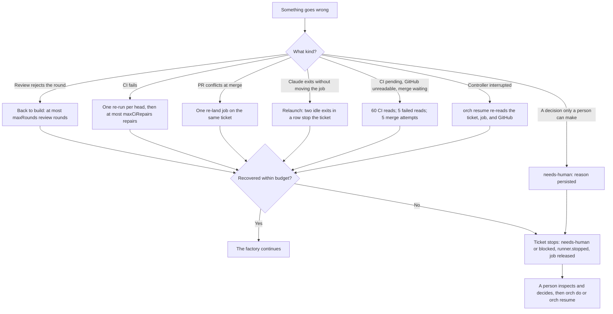

# Operating orch

How to run the factory day to day, what each command actually does, and how to recover when
something stops. [overview.md](overview.md) explains the architecture, [workflow.md](workflow.md)
the rules every job follows, [tickets.md](tickets.md) the queue, and [dashboard.md](dashboard.md)
the UI. `orch <command> --help` is the reference for every option.

## A walkthrough

### 1. Create tickets

A ticket is something to do in one repository; the queue is global. File one from inside the
repository it belongs to (or pass `--repo <path>`):

```sh
cd ~/code/my-app
orch ticket add "Export reports as CSV" --type feature --area web --priority P2 --effort 1 --body-file csv.md
orch ticket add "Fix verification race" --type bug --priority P1 --area core
```

The id comes from one global sequence (`0085`; `85` and `#85` name the same ticket). The body is
Markdown; a `- [ ]` checklist in it matters later, because a ticket with an unchecked item is not
closed by a merge (see [workflow.md](workflow.md#verified-integration-and-reconciliation)). The
dashboard's **New ticket** form does the same, for a repository that already has a ticket or a
job. The `/log-todo` skill files tickets through the same commands.

### 2. Prioritise and set dependencies

```sh
orch ticket edit 85 --priority P1
orch ticket dep add 85 62          # 0085 waits until 0062 is done
orch ticket related add 85 70      # informational only
orch ticket order                  # proposed order of the open tickets
orch ticket ready                  # what can be executed now, in that order
orch ticket blocked                # what cannot, each with its reasons
```

Readiness is more than priority. A ticket is ready when it is `open`, is not a `question`, every
dependency is `done`, no unfinished job is linked to it, and its repository checkout exists. The
order is dependencies first, then ranked tickets by rank, then priority, effort (smallest first),
area, and id. The controller takes the first ready ticket, so moving a ticket
(`orch ticket move <id> --top`), changing a priority, or adding a dependency changes what runs
next. Rules: [tickets.md](tickets.md#order-and-readiness).

### 3. Configure the repository

Two things must be true before the controller starts a ticket's job:

```sh
cd ~/code/my-app
orch init --from-package-json      # propose factory.json from package.json scripts
git add factory.json && git commit -m "Add factory verification policy" && git push
orch init --check                  # READY, or exactly what is missing
orch factory config merge enable --repo ~/code/my-app
orch factory config merge status --repo ~/code/my-app
```

`factory.json` on the base branch is the verification policy `orch verify` runs; without it no job
can pass its gates ([workflow.md](workflow.md#verification-evidence)). The merge opt-in
(`mergeRepos` in your own `<config>/factory.json`, never in a repository) lets `orch` merge that
repository's verified PRs without a click. In the global queue a ticket of a repository without
the opt-in is passed over; `orch do` refuses to start a job for it.

### 4. `orch start`: work the whole queue

```sh
orch start
```

The controller takes the controller lock of its scope (one per repository, or the whole queue's,
which runs alone; a second start that overlaps a live one is refused, see
[workflow.md](workflow.md#two-repositories-at-once)), writes its intent to its slot's
`runner.json` (`<data>/` for the whole queue, `<data>/runners/<key>/` for a repository), and
loops:

1. First take again a ticket passed over in this session for a person whose job a person has
   since moved on (decision 2026-11-24-default-needs-human-choices). Else look for a stranded
   in-progress ticket: its active job is `pending` or `running`, not in
   `needs-human` or `completed`, and unowned or with an expired lease (for example one sent back
   with `orch factory resume <job> --to build --release`), and the ticket was not passed over in
   this session. Take the first in queue order and continue its job the way `orch do` does. Only
   when there is none, read the ready queue (`orch ticket ready` across every repository). Either
   way, pass over and record as skipped any ticket whose repository lacks the merge opt-in
   (decision 2026-11-24-queue-resumes-stranded-tickets).
2. For the first remaining ticket, find its job: continue the unfinished one, create one
   (`orch factory dispatch --ticket`, which claims the ticket in the job's insert transaction), or,
   for an in-progress ticket whose last job completed, go straight to the merge.
3. In an agent stage (`spec` to `pr`), launch `claude -p "/factory <job>"` in the job's worktree as
   session `orch-runner`, and wait for the process to exit. Only the process ending ends the
   wait. Then read the job row: the row, not the exit code, is the outcome. Meanwhile each step
   it reports is a short `claude:` line on the controller's stderr (its `stream-json` output),
   its own stderr passes through, and the Session tab shows its transcript: the session id is
   attached to the job before it starts (decision 2026-11-23-live-claude-output).
4. In `ci` with a PR, read GitHub itself (the operation behind `orch gh ci`), sleeping the
   returned `waitSeconds` between reads. A verdict that sends the job back to `build` starts a
   new Claude session.
5. When the job is `completed`, merge through `mergeJob`, the same operation as `orch job merge`.
   A conflict creates one re-land job, which runs the same way. Its branch starts at the old
   job's branch head, and its builder merges the base and resolves the conflicts.
6. A ticket whose merge was verified and whose lifecycle says `done` is finished; take the next.

A ticket whose job waits for a person is released and passed over for the rest of the session,
until a person decides it on the dashboard: the running queue then takes it again before the next
ready ticket (decision 2026-11-24-default-needs-human-choices). The queue takes the next ready
ticket, and the end-of-session summary lists the passed-over ticket
with its next step. So is a completed job whose merge only a person can unblock (`personMergeStep`
in `src/core/workflow.ts`): `workflow-changed` (next step: Merge on the dashboard),
`not-authorized`, `head-changed`, `pr-closed`, `pr-draft`, `second-conflict`, and `base-moving`
(decision 2026-11-23-queue-passes-over-person-merge-blocks). So is every other ticket that ends `blocked`
or `refused` for a reason of its own, such as a merge that left a checklist box open
(`ticket-open`; next step: tick or move the remaining boxes, then `orch ticket done <id>`), an
unverified merge, or a job that made no progress. The run ends when no ready ticket is left,
when `orch stop next` was requested, or at the first ticket whose outcome would hit every ticket:
claude cannot start (`claude-failed`), Claude's usage or rate limit is reached (`usage-limit`),
GitHub cannot be read or gives no answer (`github-unreadable`, `merge-no-answer`), or GitHub
refuses the merge call (`github-refused`). A `usage-limit` stop leaves the session unfinished
with its ticket in flight: the summary names the limit and its reset time when Claude printed
one, and `orch resume` continues the same ticket and job once the limit has reset (decision
2026-11-24-usage-limit-ends-run-resumably). A limit on `fable`, which has an allowance of its
own, does not end the run while every role of the job drawn `fable` has another model in its
pool: the controller records `models.fallback` on the job and launches again on that model
(decision 2026-11-26-per-model-limit-falls-back). The same holds when `orch` was rebuilt since the
controller started (`orch-rebuilt`) or `factory.json` fails validation (`bad-config`), both
checked before each ticket and each Claude launch; a stop before a ticket leaves none in flight,
and `orch resume` then takes a stranded in-progress ticket first (decision
2026-11-25-environment-stops-are-resumable). On `orch-rebuilt` the controller then hands the
session to the new build itself: it runs the installed `orch resume` for the same slot in the
same terminal, waits for it, and exits with its code; a handoff refused at once (non-zero within
10 s) is reported and leaves the session for your `orch resume` (decision
2026-11-26-rebuilt-controller-hands-off).
Those codes are `RUN_ENDING_CODES` in `src/core/workflow.ts`; a code not named there continues
the queue (decision 2026-11-23-queue-ends-only-on-run-wide-outcomes). It exits 0 unless a ticket
ended blocked, refused, or waiting for a person, or the run stopped on a rebuild or a bad
`factory.json` (`interrupted` in the JSON).

The end-of-session summary (also `--json`, as `merged`) is the report to read after an
unattended run, in four parts: **Merged**, each done ticket with its job, merged head, merge
commit, and its PR as the receipt (the PR body carries the merge receipt); **Needs you**, each
ticket that ended `needs-human`, `blocked`, or `refused`, with its reason and `next:` command (a
job still waiting in needs-human leads with what is needed and one line per choice with its
`?choose=<n>` dashboard link, as the stop line, `orch status`, and the status mail do; `waiting`
in the JSON);
**Passed over**, each skipped ticket and other unfinished result, with why; and the cost of each
merged ticket's result job only (after a re-land, the re-land job): the summed `runner.session`
seconds and recorded token counts, or "not recorded". Nothing estimates it, and nothing decides
from it.

### 5. `orch start repo`: one repository

```sh
cd ~/code/my-app && orch start repo
```

The same loop, restricted to the tickets of the repository containing the current directory.

### 6. `orch do <ticket-id>`: one ticket

```sh
orch do 85
```

Runs that one ticket to its outcome and exits, whatever the outcome: start its job, continue the
unfinished one, or merge the completed one. Without the merge opt-in it refuses to create a new
job, but it still continues an existing one; that job's merge is then refused with
`not-authorized`, which ends the ticket as `blocked`. Cancelling a job reopens its ticket, so `orch do 85`
then gives it a new job; `orch ticket drop 85` stops it for good.

### 7. `orch status`: what is happening

```sh
orch status
orch status --json
```

Prints the controller state (`running`, `interrupted`, or `idle`), its mode and scope, the ticket
and job in flight with stage, status, and repository, what it waits on (`agent`, `ci`, `merge`, or
`human`), the Claude child's PID and whether it is still alive, any pending stop request, one
sentence saying what happens next, and how the last finished session ended (its reason and the
done-of-attempted count). Everything except the controller's own record is read from the job
row. The dashboard's Tickets section shows the same, read-only, from `GET /api/runner`.

### 8. `orch stop next`: finish this ticket, then exit

```sh
orch stop next
```

Leaves a request (`<data>/runner.stop-next`) that the controller reads at the ticket boundary: the
current ticket runs to its outcome, re-land included, and no further ticket is started. Against
an interrupted session it is kept, so `orch resume` finishes the ticket in flight and exits.

### 9. `orch stop`: stop now

```sh
orch stop          # or Ctrl+C in the controller's terminal
```

Leaves `<data>/runner.stop-now`. The controller terminates the Claude process it started, records
a `runner.session` event with outcome `stopped`, releases the job in the state it was in, and
exits, keeping the session for `orch resume`. Nothing is cancelled; the job keeps its stage,
artifacts, and worktree. With no controller alive, `orch stop` discards an interrupted session
instead (refused while that session's Claude child may still be running). No `runner.stopped`
event is written for a stop you asked for.

### 10. `orch resume`: continue an interrupted session

```sh
orch resume
orch resume --force   # only when the recorded child PID now belongs to another program
```

Continues the session `runner.json` describes, with the same scope, ticket, job, and stop
request. It re-runs the ticket from durable state: the ticket's jobs are read again, so the same
unfinished job continues from its stage, a completed job goes to the merge, and a merge GitHub
already made is recorded rather than repeated. Then the queue goes on as configured.
`orch start` and `orch do` refuse while an interrupted session exists; resume it or discard it
with `orch stop` first.

### A typical session

```sh
orch ticket ready                         # 0085 and 0091 are ready
orch start                                # takes 0085
orch status                               # in another terminal: 0085, job at review, waiting for agent
orch stop next                            # finish 0085, then exit
# ... 0085 merges and closes; the controller exits 0
orch start                                # later: takes 0091, whose job escalates, then the rest
# the summary lists: 0091 needs-human: <what is needed>, a ?choose= link per choice, then the reason
orch job events <job-id> --limit 20       # runner.stopped says why and what to run next
orch ui                                   # open a choice's link (or the job page) and confirm it
orch do 91                                # continues the same job
orch start                                # back to the queue
```

## Running a job without the controller

The controller is one way to drive jobs. A job can also be run from a Claude Code session, and
many jobs can run at once that way.

**From a session.** In a Claude Code session opened in the repository:

```
/factory Add a feature to export reports as CSV      start a job for this repository
/factory job-1a2b3c4d                                continue or adopt a job
/factory status job-1a2b3c4d                         report without changing anything
```

The session claims the job (a 30-minute lease, renewed by every command it runs), creates a
worktree under the runtime data directory on branch `factory/<id>-<slug>`, and loops on
`orch factory next <id> --json`, which returns the plan: the step, the agents to launch with their
models, the artifact each must write, the worktree state, and the exact `orch` commands to run.
Every state change is a CLI call `orch` validates. The same loop works from a shell without Claude
(`orch factory start`, `next`, `resume`; see `orch factory --help`). Every job needs its request:
`--description`, or `--issue` so the description is fetched from the issue; a job with a missing or
blank description is refused (exit 2) and nothing is created. `orch factory start --ticket 85`
creates the job for a ticket and marks the ticket in progress in the same transaction.

Run a single job in the interactive session: it shows progress and you can type to it. A headless
`claude -p` session cannot be messaged; for unattended work use the controller (`orch start`, `orch do <ticket>`), one ticket at a time.
Either way, `orch factory next` shows the session outside events on its next call (base moved, PR
merged, cancelled) and any message left with `orch job notice post <id> --message "<text>"`, until
the session acknowledges it ([workflow.md](workflow.md#session-notices)).

**Several jobs.** The skill no longer launches sessions for other jobs (decision
[2026-11-25-retire-dispatch-launch](decisions/2026-11-25-retire-dispatch-launch.md)). File each
request as a ticket and run `orch start` or `orch do <ticket>`, or run `/factory <job>` in one
interactive session per job. `orch factory dispatch` still creates a job without claiming it
(no worktree, no session); repeating it for the same repository and issue returns the existing
job. `orch factory list` shows one row per job with its stage, status, whether a human is needed
(ACTION), PR, and title; `--json` adds the owner, the attached session, and the resume command for
jobs no live session holds. Archiving a VS Code session whose worktree a job adopted removes that
worktree, which is the job's worktree.

**Inspecting and resuming a job.**

```sh
orch factory list                     # every job, every repository
orch factory status job-1a2b3c4d      # where it is, what blocks it, next step, numbered commands
orch job events job-1a2b3c4d          # the audit log
orch verify show job-1a2b3c4d         # latest verification run and whether it still counts
orch job usage job-1a2b3c4d           # where the job's time went
orch ui                               # dashboard at http://127.0.0.1:4777/ (optional)
```

A job whose session stopped keeps its state. `/factory <id>` in any session resumes it: it takes
over the lapsed lease (a live one needs `--force`, which rotates the token so the old session's
commands fail, and the skill forces only when the previous session has clearly died), recreates
the worktree if it is gone, re-verifies every registered artifact, and continues from the plan.

**Merging and cleaning up.** A human merges on GitHub, or clicks Merge in the dashboard, which
merges exactly the verified head; Refresh PR records a merge done on GitHub. `orch job merge <id>`
runs the same checked merge without a click, only for a repository you opted in, confirms the
result with GitHub, records the merge commit, and closes the job's ticket when no checklist item is
left unchecked ([workflow.md](workflow.md#merging)). A PR a human merges while CI is still running
completes the job when it is the verified, approved head. Nothing removes a job's worktree on its
own: once the PR is merged, the dashboard offers Remove worktree (or run `orch worktree remove`, no
token needed for a finished job); the branch is kept.

## Stop, stop next, and resume

| request          | read                        | effect on the Claude child                   | effect on the job                   | afterwards                                      |
| ---------------- | --------------------------- | -------------------------------------------- | ----------------------------------- | ----------------------------------------------- |
| `orch stop next` | at the next ticket boundary | none; the current ticket runs to its outcome | none                                | the controller exits; the session is finished   |
| `orch stop`      | within seconds (polled)     | terminated by the controller that started it | released as it was; never cancelled | the session is left for `orch resume`           |
| Ctrl+C           | the same as `orch stop`     | the same as `orch stop`                      | the same                            | the same                                        |
| crash, reboot    | never                       | may survive the controller                   | its lease lapses                    | `orch status` says `interrupted`; `orch resume` |

`orch resume` never trusts what was in flight: it reads the ticket's jobs, the job row, and
GitHub again, so continuing is the same as calling `runTicket` once more. Only the stage that was
interrupted is redone, from its registered artifacts.

### A Claude process that may have survived

The controller records its child's PID and start time in `runner.json`. If the controller died,
that child may still be running and still working on the job. Two agents must never work one job,
so `orch resume` (and `orch stop` against an interrupted session) reads the OS start time of the
process at the recorded PID. If it started within 10 s before to 60 s after the recorded start, it
is the child (identity confirmed) and the command refuses. If it started at another time, the PID
was reused and the command goes ahead. If the start time cannot be read, the identity is unknown
and the command refuses:

```
The Claude process the interrupted controller started on job job-1a2b3c4d (PID 12345, recorded
start 2026-11-23T10:00:00.000Z) is still running: the process at that PID started then (identity
confirmed). orch does not signal a PID it only read from a file. Inspect it with: Get-Process -Id
12345 | Select-Object Id,StartTime,Path. If it is that Claude process, wait for it to exit or end
it yourself, then run orch resume again. Only if it is another program, run orch resume --force.
```

What to do:

1. Inspect the PID with the command the message gives (`Get-Process -Id <pid>` on Windows,
   `ps -o pid,lstart,command -p <pid>` elsewhere).
2. If it is the Claude process, either wait for it to finish its turn and exit, or end it yourself.
3. Run `orch resume` (or `orch stop`) again.
4. Only if that PID belongs to another program, run `orch resume --force`.

`orch` never signals a PID it only read from a file and never adopts a surviving process: it
cannot prove the process is still its child, and attaching to an agent mid-turn would have no
supported interface.

## Observing and diagnosing

### Blocked outcomes

Each ticket the controller attempts ends with one outcome (`TICKET_OUTCOMES` in
`src/ops/runner-state.ts`):

| outcome       | meaning                                                                        | in the queue                       |
| ------------- | ------------------------------------------------------------------------------ | ---------------------------------- |
| `done`        | the ticket's lifecycle says done: a verified merge closed it, now or earlier   | continue with the next ticket      |
| `claimed`     | another process created the ticket's job meanwhile                             | pass that ticket over and continue |
| `blocked`     | started, and cannot go on without a person (a budget, a refusal, a cancel)     | pass that ticket over and continue |
| `needs-human` | its job waits in `needs-human`, or its merge only a person can unblock         | pass that ticket over and continue |
| `refused`     | nothing was started (not open, not authorized for `orch do`, dispatch refused) | pass that ticket over and continue |
| `stopped`     | `orch stop` interrupted it                                                     | end the run, resumable             |

The one exception is a result whose code would hit every ticket (`RUN_ENDING_CODES` in
`src/core/workflow.ts`: `claude-failed`, `usage-limit`, `github-unreadable`, `merge-no-answer`,
`github-refused`, `orch-rebuilt`, `bad-config`): it ends the run with the reason; after
`usage-limit`, `orch-rebuilt`, or `bad-config` the run stays resumable.
A GitHub failure that `transientGitHubError` calls transient (5xx, GraphQL "Something went
wrong", timeouts, network errors; never a refusal or a rate limit) is first retried after 1, 2, 4,
8, and 16 minutes (`GITHUB_BACKOFF_SECONDS`, decision 2026-11-25-bounded-github-retry); `orch stop`
ends the wait. A ticket of a repository without the merge
opt-in is not an outcome: the queue records it as skipped and moves on. `orch do` reports its one
ticket's outcome and exits either way.

### Runner events on the job

What the controller did to a job is written to the job's own event log as `orch-runner`, so it
outlasts `runner.json` (which the next session replaces) and the controller process. Two event
types:

`runner.session`, each time a Claude process the controller started has ended:

| field        | meaning                                                                                                         |
| ------------ | --------------------------------------------------------------------------------------------------------------- |
| `outcome`    | `exited` (ended on its own), `stopped` (by `orch stop`), `failed` (did not start)                               |
| `exitCode`   | the process exit code, or null                                                                                  |
| `signal`     | the signal that ended it, or null                                                                               |
| `error`      | why it could not be started, or null                                                                            |
| `pid`        | the child's PID; null when it never started                                                                     |
| `seconds`    | wall-clock duration                                                                                             |
| `moved`      | whether the job's stage, round, CI repairs, or artifact count changed meanwhile                                 |
| `stage`      | the job's stage afterwards                                                                                      |
| `status`     | the job's status afterwards                                                                                     |
| `sessionId`  | the `--session-id` it ran under, also attached to the job before it started                                     |
| `stderrTail` | the last 4000 characters it wrote to stderr, or null                                                            |
| `result`     | its final stream-json `result` (`subtype`, `isError`, `result` clipped, `numTurns`), or null                    |
| `pick`       | how the queue took the ticket: `resume` (stranded in-progress, or taken again) or `ready`; absent for `orch do` |

**Exit code 0 is not success.** `exited` with `exitCode` 0 says only that the process ended;
`moved` says whether the job got anywhere, and the job row says where.

`runner.stopped`, when a ticket ends `blocked` or `needs-human` and its job is not cancelled:

| field     | meaning                                                           |
| --------- | ----------------------------------------------------------------- |
| `outcome` | `blocked` or `needs-human`                                        |
| `code`    | the structured stop code (below)                                  |
| `reason`  | the human-readable reason                                         |
| `stage`   | the job's stage when the controller gave the ticket up            |
| `status`  | the job's status then                                             |
| `next`    | the command or decision that continues it                         |
| `pick`    | `resume` or `ready`, as on `runner.session`; absent for `orch do` |

Stop codes `src/ops/run.ts` can write:

- the controller's own: `no-progress` (two Claude sessions in a row without moving the job),
  `claude-failed` (Claude could not be started), `usage-limit` (the session ended on a Claude
  usage or rate limit; next step `orch resume`), `ci-pending` (60 CI reads without a verdict),
  `github-unreadable` (five unreadable GitHub answers in a row during CI, six for a transient
  failure), `unverified-merge` (the
  PR merged at a head other than the verified one), `ticket-open` (merged and verified, but the
  ticket stays open, for example an unchecked checklist item), `reland-refused` (a conflict, and no
  re-land job could be created), `merge-no-answer` (five merge attempts answered `waiting`, or six
  answered `error`), `ownership` (an `orch` operation refused because another session held the job), and
  `error` (any other `orch` refusal);
- `needs-human`, the outcome used as the code, when the job waits for a person;
- any `blocked` code `mergeJob` returns (`MERGE_BLOCKS` in `src/core/workflow.ts`): `no-pr`,
  `not-completed`, `wrong-completion`, `no-ci-evidence`, `superseded`, `wrong-repository`,
  `wrong-base`, `wrong-head-branch`, `pr-closed`, `pr-draft`, `head-changed`, `workflow-changed`,
  `not-authorized`, `conflict`, `second-conflict`, `reland-refused`, `base-moving`,
  `reopen-refused`, `github-refused`. Those only a person can lift (`workflow-changed`,
  `not-authorized`, `head-changed`, `pr-closed`, `pr-draft`, `second-conflict`, `base-moving`) come with outcome `needs-human` and that person's step as `next`;
  the rest with `blocked`;
- `merge-blocked`, the fallback when `mergeJob` blocks without a code.

Nothing is written: for a cancelled job (its `job.cancelled` already says why); for a stop you
asked for (`orch stop`, `orch stop next`, Ctrl+C); when the same code and reason are already the
job's last news (running `orch do` again changed nothing); and to a job another session holds,
which is left exactly as it is.

Where to see them: `orch job events <id>` (newest last; `--limit <n>`, `--json` for the payloads),
the dashboard job detail's **Events** tab, and, for `runner.stopped`, the status mail when mail is
configured. They stay on the job after the controller exits. They are evidence only: nothing in
`orch` decides from them. The job's own events (`stage.*`, `job.blocked`, `ci.observed`,
`pr.merged`, ...) describe the job; runner events describe the controller.

### Diagnosing CI failures

The controller reads CI with the same rules as `orch gh ci` ([workflow.md](workflow.md#ci-reconciliation)).

- `orch factory status <id>` and the dashboard's PR tab show the head the verdict is for, the
  failing required checks with their GitHub log links, and the repair budget (`n of m repairs used`).
- Failed Actions job logs are saved under `<data>/jobs/<id>/artifacts/ci/<sha7>/` before a repair;
  the builder gets them in its plan.
- A failed check is re-run once per head (`ci.rerun`) before anything is repaired. A second
  failure for the same head sends the job back to `build` (`ciRepairs` + 1) until `maxCiRepairs`
  is spent, then `needs-human` with `max CI repair cycles reached`.
- `cancelled`, `startup_failure`, `stale`, or `action_required` twice, no checks at all, a closed
  PR, or a head moved outside the job escalate: they are not code defects. Fix GitHub Actions (or
  the branch), then resume `--to ci` on the dashboard (Resume at ci) and `orch do <ticket>`.
- `ci-pending` means the controller read GitHub 60 times without a verdict; `github-unreadable`
  means five reads in a row failed. Neither changed the job: `orch do <ticket>` reads again.

### Diagnosing merge failures

`orch job merge <id> --json` prints `outcome`, `code`, `reason`, `prHead`, `verifiedHead`,
`mergeCommit`, `verified`, and the ticket's settlement, and is safe to repeat.

- `waiting`: GitHub has not computed mergeability; call again. The controller tries five times,
  30 s apart, then stops with `merge-no-answer`.
- `blocked` / `not-authorized`: enable the repository (`orch factory config merge enable --repo
<path>`) or click Merge on the dashboard, which needs no opt-in.
- `blocked` / `head-changed`: the PR head is not the CI-verified head; a person looks at what
  moved the branch.
- `blocked` / `workflow-changed`: the PR adds, edits, deletes, or renames a file under
  `.github/workflows/` by GitHub's file list for the PR (or GitHub could not give the complete
  list), so it changed what CI runs; a person
  reviews the workflow change and clicks Merge on the dashboard. No setting lifts this.
- `blocked` / `github-refused`: branch protection or a repository setting refused the merge; gh's
  message is recorded on `pr.merged` with `ok: false`. When the message looks transient, the
  controller (not `orch job merge`) tries again on the backoff schedule first.
- `merged` or `already_merged` with `verified: false`, or a ticket that stays open: see
  [workflow.md](workflow.md#verified-integration-and-reconciliation). Tick what was delivered
  (`orch ticket edit <id> --body-file <file>`) and run `orch job merge <job>` again, or close the
  ticket with `orch ticket done <id>`.

### Recovering an interrupted re-land

A conflict creates the re-land job, marks the old job superseded, and keeps the ticket, all in
one transaction, so there is no half-created re-land. The re-land is the ticket's unfinished job
from then on: `orch resume` (for the interrupted session) or `orch do <ticket>` continues it from
its stage like any job. Its worktree, once created, starts at the old job's branch head
(`worktree.created` records `from`); if that branch is gone, it starts from the base and the plan
says the work is re-implemented. `orch ticket jobs <id>` lists both jobs; the superseded job's PR is left
open (orch closes no PRs). If the re-land conflicts too, the merge stops with `second-conflict`
and no third job is created.

## Resolving needs-human

A job enters `needs-human` when the workflow reaches a decision code will not make: an approver's
`ESCALATE`, a review round that still requests changes at `maxRounds`, a second scope gap, a spent
CI repair budget, CI that is not a code defect, a verification policy the job proposed, or a
failure the skill escalated. End to end:

1. The factory session escalates; `job.blocked` records the reason and the stage it came from.
2. The controller sees `needs-human` when the child exits, writes `runner.stopped`
   (`code: needs-human`), and releases the job even if the escalating session did not. `orch do`
   ends there; `orch start` passes the ticket over for the rest of the session, goes on with the
   next ready ticket, and lists it in the end-of-session summary. Either exits 1.
3. Inspect: `orch factory status <id>`, `orch job events <id>`, and the dashboard's job detail,
   which shows the blocker, the approver's `DECISION` with its rationale, and the newest round's
   blocking findings.
4. Decide, with a reason, through a real mechanism:
   - the dashboard: **Resume at `<stage>`**, **Request rework**, **Request review round**,
     **Accept verification policy**, **Accept delivery** (only for a `ci` escalation where GitHub
     reported no checks or the PR was merged by hand), or **Cancel**; for a base conflict in
     `approve`, `pr`, or `ci`, or on a completed job's open PR, **Fix merge conflicts**;
   - or the CLI: `orch factory resume <job> --to <stage>`. With `--to` the resume gives the job
     up again at once (`token: null`), so `orch do` can continue it; `--release` is redundant but
     accepted. For a spec the challenger rejected twice, edit
     `<artifactDir>/spec.md` first and resume at `spec`; the next plan registers the edit and
     re-challenges it.
5. Continue: `orch do <ticket>` runs the same job from the chosen stage; `orch start` afterwards
   goes on with the queue.

A Cancel returns the job's ticket to open, so the controller gives it a new job on its next pass;
`orch ticket drop <id>` closes it instead.

## Recovery budgets

Every automatic recovery is bounded. A spent budget is not a success: it stops the ticket with
its reason. The queue passes a `blocked` ticket over and goes on, except for the run-wide codes
`claude-failed`, `usage-limit`, `github-unreadable`, and `merge-no-answer` (and `github-refused`
at merge), which end the run there, after the bounded backoff on a transient GitHub failure
(decision 2026-11-25-bounded-github-retry).



| failure                            | budget (code)                                                                                                                                                                                                                       | counted in                                  | survives a new controller session         |
| ---------------------------------- | ----------------------------------------------------------------------------------------------------------------------------------------------------------------------------------------------------------------------------------- | ------------------------------------------- | ----------------------------------------- |
| review rejects a round             | `maxRounds`, default 3 (1–10 in `factory.json`, `--max-rounds` per job); base-integration rework, CI repair, a human resume to build/simplify/review, and a scope rework raise the limit instead of spending it; then `needs-human` | job row (`round`, `maxRounds`)              | yes, durable                              |
| scope gap (`REWORK-BUILD`/`-SPEC`) | one automatic rework, then `needs-human`                                                                                                                                                                                            | job row (`scopeReworks`)                    | yes, durable                              |
| spec challenge says CHANGES        | one revision; a second CHANGES escalates (a bound set by the plan, not a code cap)                                                                                                                                                  | the registered `spec-review-N.md` files     | yes, durable                              |
| `orch verify` fails                | the builder gets the failing log once, then the skill fails the stage and escalates; the gate never opens without a passing run                                                                                                     | the factory session (skill rule)            | not counted                               |
| CI fails                           | one re-run per head, then `maxCiRepairs`, default 2 (0–10), then `needs-human`                                                                                                                                                      | job row (`ciRepairs`) and `ci.rerun` events | yes, durable                              |
| PR conflicts at merge              | one re-land job; a second conflict blocks with `second-conflict`                                                                                                                                                                    | job rows (`supersededBy`)                   | yes, durable                              |
| Claude exits without progress      | `MAX_IDLE_LAUNCHES` = 2 consecutive exits that change none of stage, round, CI repairs, artifact count (`no-progress`)                                                                                                              | the running controller                      | no: reset by `orch do`, `resume`, `start` |
| Claude cannot be started           | none: stops at once (`claude-failed`)                                                                                                                                                                                               | –                                           | –                                         |
| Claude usage or rate limit         | none: ends the run at once, unfinished, for `orch resume` (`usage-limit`)                                                                                                                                                           | the session file                            | yes, until `orch resume` or `orch stop`   |
| CI pending                         | `CI_MAX_POLLS` = 60 controller reads (`ci-pending`)                                                                                                                                                                                 | the running controller                      | no: reset                                 |
| GitHub unreadable during CI        | `TRANSIENT_ATTEMPTS` = 5 consecutive failed reads, or 6 transient ones `GITHUB_BACKOFF_SECONDS` apart (`github-unreadable`)                                                                                                         | the running controller                      | no: reset                                 |
| merge `waiting` or `error`         | `waiting`: 5 attempts, `RETRY_SECONDS` = 30 s apart; `error`: 6 attempts, `GITHUB_BACKOFF_SECONDS` apart (`merge-no-answer`)                                                                                                        | the running controller                      | no: reset                                 |
| recovery worker episode fails      | 5 consecutive `recovery.failed` for one CI head, then `needs-human`                                                                                                                                                                 | job events                                  | yes, durable                              |
| a person must decide               | none: the job waits in `needs-human`                                                                                                                                                                                                | job row (`stage`, `returnStage`)            | yes, durable                              |

The runner-local counters start again with each `orch do`, `orch resume`, or `orch start`, and
each of those takes a person, so a retry loop always has someone in it. Nothing waits between two
sessions, and nothing ends a Claude session for running long.

**Recovery worker.** Separate from the controller and opt-in: `orch recover start` (or
`orch recover run` in the foreground) continues only `ci`-stage jobs with a PR that no live
session owns, as session `orch-recovery`, once GitHub answers again. It never forces a live
lease, never launches or messages a Claude session, and reports jobs stalled in an agent stage
with their resume command ([workflow.md](workflow.md#recovery-worker)).

## Intentional limitations

orch favours bounded, inspectable autonomy. Each boundary below is a design choice that keeps
failures understandable:

- **No permanent daemon.** `orch start` is a foreground command and everything ends with it.
  Nothing can keep an agent working unnoticed after you close the terminal.
- **One ticket at a time per repository.** Serial work on one base branch needs no merge queue
  and causes few conflicts. One controller per repository may run at once, since repositories
  share no head; verifications still run one at a time on one machine.
- **No unlimited retries.** Every automatic recovery has a budget (above). An endless loop becomes
  a ticket that waits for a person, with the reason recorded.
- **No bypass of required CI or merge verification.** No flag skips a gate; the merge is pinned
  to the CI-verified head with `--match-head-commit` and never uses `--admin`.
- **No silent continuation after a ticket failure.** A ticket that ends blocked, refused, or
  waiting for a person is passed over, never hidden: it is printed with its next step, recorded
  as `runner.stopped` on its job, listed in the summary, and makes the exit status 1; tickets
  that depend on it stay unready. Only an outcome that would hit every ticket ends the run
  (`RUN_ENDING_CODES`, decision 2026-11-23-queue-ends-only-on-run-wide-outcomes).
- **No wall-clock termination of Claude children.** A builder or a test run can be quiet for a
  long time; silence is not evidence of failure. Only the process ending ends the wait.
- **No automatic adoption of surviving child processes.** A PID read from a file cannot prove it
  is still orch's child, and there is no supported way to attach to an agent mid-turn. A person
  checks and resumes.
- **No second implementation of the factory in TypeScript.** The controller launches `/factory`
  and reads the job row; the stages exist once, in the skill and its gates.
- **No generic agent-chat framework.** Sessions read notices on their next `orch factory next`;
  nothing types into a session, so no job depends on a message arriving.
- **No new orchestration platform.** One SQLite database, a CLI, Git, `gh`, and Claude Code. No
  queue service, workflow engine, or process supervisor to install or keep alive.
- **No automatic resolution of genuinely ambiguous decisions.** `needs-human` is a stage the job
  cannot leave by itself; a person's decision is recorded with a reason.
- **No assumption that a successful exit is successful engineering.** Exit code 0 is a hint; the
  job row, its validated artifacts, and GitHub's verdict for the exact head are the outcome.

## Operational evidence and metrics

The principal measure of the factory is **verified tickets completed per hour of human
attention**. The numerator is recorded; the denominator is not. What exists today, in four
classes:

| measure                             | recorded                                                  | derivable now                                      | shown in the UI                                     | needs new instrumentation or interpretation         |
| ----------------------------------- | --------------------------------------------------------- | -------------------------------------------------- | --------------------------------------------------- | --------------------------------------------------- |
| job wall-clock duration             | job `createdAt`, `completedAt`, events                    | `orch job usage` `wallMs`                          | board and detail: Elapsed                           |                                                     |
| time in stages                      | `stage.started` and the event that ended it               | `orch job usage` `stages`, `stageMs`               | Overview: Progress and Timeline (times, not totals) |                                                     |
| review duration                     | review records (pending, then verdict)                    | `orch job usage` `reviews`, `reviewMs`             | Reviews tab (verdicts)                              |                                                     |
| review and rework rounds            | job `round`, `maxRounds`; `job.reworked`                  | yes                                                | Round column `N / M`                                |                                                     |
| CI repair attempts                  | job `ciRepairs`                                           | `orch job usage` `ci.repairs`                      | `repairs n/m` caption; CI line in detail            |                                                     |
| CI re-runs and observations         | `ci.rerun`, `ci.observed` events                          | `orch job usage` `ci.reruns`, `ci.observations`    | PR tab (latest observation)                         |                                                     |
| merge conflicts and re-lands        | `supersededBy`, `pr.observed` mergeable                   | count re-land jobs per ticket (`orch ticket jobs`) | supersession links; ticket Jobs table               |                                                     |
| blocked jobs                        | `job.blocked` events, `needs-human` stage                 | yes, from events                                   | status chip and blocker line; `n need human` chip   |                                                     |
| human interventions                 | `job.resumed`, dashboard actions with reasons             | count by actor and type from events                | Events tab                                          | time spent by the person                            |
| runner sessions and their durations | `runner.session` (`seconds`, `moved`)                     | count and sum per job from events                  | Events tab (raw); last session reason and counts    |                                                     |
| verified ticket completion          | `ticket.completed`, `pr.merged` (`verified`)              | yes, from ticket and job events                    | ticket state; runner strip done-of-attempted        |                                                     |
| reviewer findings                   | `round-N/review-*.md`, `consolidated.md` with `BLOCKING:` | counts per round from artifacts                    | Reviews and Findings tabs; `n blocking`             | classifying findings over time                      |
| tokens and cost                     | not recorded                                              | no                                                 | no                                                  | yes: `orch job usage` says `tokens.measured: false` |
| human attention time                | not recorded                                              | no                                                 | no                                                  | yes: the denominator of the principal measure       |

`orch job usage <id>` (`--json`) is the one report today; it reports measured durations and
configured models and states that token counts are not measured. There is no analytics or usage
view in the dashboard. **Optional future work**, not needed to operate the factory: a Runs view
over `runner.session` and `runner.stopped` events across jobs, and an Agents view of time per
role. Neither exists, and neither is a prerequisite for anything above.

## Backup and restore

Everything orch knows lives in one data directory: `%LOCALAPPDATA%\orch` on Windows,
`~/Library/Application Support/orch` on macOS, `$XDG_DATA_HOME/orch` (default
`~/.local/share/orch`) on Linux, or `<dir>` when `ORCH_HOME=<dir>` is set. The database is
`<data>/orch.sqlite`; job artifacts are under `<data>/jobs/<id>/artifacts/` and ticket assets under
`<data>/tickets/<id>/assets/` ([Where things live](../README.md#where-things-live)).

```sh
orch backup create D:\backups\orch.tar.gz            # refuses an existing file; --force replaces it
orch backup restore D:\backups\orch.tar.gz           # into the data directory (must be empty)
orch backup restore D:\backups\orch.tar.gz --data-dir C:\tmp\orch-test   # a test restore
ORCH_HOME=C:\tmp\orch-test orch ticket list          # inspect the test restore
```

**Create** works while the controller, the dashboard, or any other `orch` command runs. The
database is copied by SQLite (`VACUUM INTO`, one read transaction, so writers keep going and
changes still in the WAL are included), never as a file. The archive holds `manifest.json`
first (format `orch-backup`, version 1, orch version, the schema's migration names, row counts per
table, every file's size and SHA-256, what is included and excluded), then `orch.sqlite`, then every
regular file under `jobs/<id>/artifacts/` and `tickets/<id>/assets/` at the same paths. Symbolic
links and other non-regular entries there are skipped and reported. Every registered artifact must
exist and match the hash in the snapshot's own row (a row registered before hashes were recorded
is only checked for presence); if an artifact is being replaced at that
moment the snapshot is retaken (three times at most), and a file still missing or changed fails
the backup and names the job and path. The archive is written to a temporary file next to
`<file>`, read back and checked (gzip, entry paths, manifest, hashes, `integrity_check`), and only
then renamed into place. `<file>` is required, and it may not be inside the data directory, the
orch installation, the Claude Code directory, or a Git working tree.

Not in the archive: `worktrees/` and `checkouts/` (Git repositories and branches live in your
repositories and on GitHub), runner state (`runner.json`, `runner-lock/`, `runner.stop-*`, `runners/`),
`verify.lock` and `verify-queue/`, the recovery worker's files, `logs/`, `tmp/`, the `-wal` and
`-shm` files (folded into the snapshot), any other file in the data directory, and user
configuration (`<config>/factory.json`, `mail.env`).

**Restore** needs an inactive, empty destination: it refuses (exit 1, nothing written) when the
destination already has `orch.sqlite` (or its `-wal`/`-shm`), anything in `jobs/` or `tickets/`,
or a live controller, recovery worker, or `orch verify` for it. There is no overwrite flag; to
replace data, move the old data directory aside first. The archive is unpacked into a staging
directory inside the destination and checked there before anything is installed: supported format
version, a complete manifest, safe entry paths only (no absolute paths, `..`, backslashes, a
colon anywhere, Windows reserved names such as `CON` or `nul.txt`, names ending in `.` or a space,
links, or paths outside the allow-list; an artifact or asset with such a name is skipped and
reported at backup time), matching hashes, `PRAGMA integrity_check`,
and every registered artifact present with its hash. A backup from an older orch is migrated
forward with the installed migrations; one whose database has migrations this orch does not know
is refused ("created by a newer orch"). The database is installed last and never over an existing
file; a failure removes the staging directory and undoes the moves. Restore does not recreate
worktrees, repositories, branches, running controllers or workers, queues, logs, or configuration;
jobs whose worktree is gone need it again before they can continue.

A backup on the same disk does not survive that disk failing: copy the archive to another drive
or machine. Archives are built in memory, which suits the usual size of a data directory.

## Email reports

Optional. Put SMTP settings in `<config>/mail.env` (see
[Where things live](../README.md#where-things-live)); an environment variable of the same name
overrides each line:

```sh
MAIL_SMTP_HOST=smtp.example.com
MAIL_SMTP_PORT=465            # implicit TLS (SMTPS) only; default 465
MAIL_USER=bot@example.com
MAIL_PASSWORD=app-password
MAIL_FROM=bot@example.com     # default MAIL_USER
MAIL_TO=you@example.com       # the only recipient
MAIL_SUBJECT_PREFIX=[orch]    # default [orch]
```

The file holds a password in plain text: keep it out of every repository and readable only by
you. With it set, mail goes out only when a person must act or a job's outcome is final: an
`orch` command (or dashboard action, recovery pass, or controller step) that records one of these
events sends one mail summarising them: the job's stage, status, PR, each event with its reason,
and `orch factory status <id>`. The mailed events are `job.blocked` (needs-human), `job.cancelled`,
`job.interrupted`, `recovery.failed`, `verification.flaky` (naming the test), `runner.stopped`
(the controller gave the ticket up), and `pr.merged` for a merge GitHub confirmed. When the job
needs something, the mail leads with it: what is needed and each choice with its link, why it
stopped, the recorded reason, and the next command or dashboard decision. The merged mail is the
receipt: the PR link, a `Merged: <merge commit>` line, and the job's cost line as the end-of-session
summary prints it (`cost of job <id> only: <time>, <tokens>`). Job creation, stage starts,
completions, and failures, resume, rework, job completion, a merge GitHub refused, CI polls, pushes,
and verification runs are not mailed; there is no option to mail them. All mails of a job share one
subject (`[orch] <id>: <title>`) and reply to the previous one, so a mail client shows them as one
conversation.
`orch mail report "<subject>" (--text "<body>" | --text-file <file>) [--reply-to <message-id>]` sends any
text the same way and prints `SENT <message-id>`.

When a controller session (`orch start`, `orch do`, `orch resume`) ends, it also sends one
session mail, subject `[orch] session ended: <n> merged, <m> need you`, whose body is the
end-of-session summary as printed. It is not threaded or recorded on any job; a configuration
error or failed send is one `session mail not sent:` line in the run's output and changes nothing
else. A controller that crashes sends none.

Limits: one recipient, plain text, implicit TLS only (no STARTTLS/587, so not providers that
require it), no replies read. A mail is sent at most once: a failed send is recorded on the job as
a `mail.failed` event, warned about on stderr, and never retried, and it never fails or undoes the
command. Unset, nothing is sent and nothing changes. Internals:
[workflow.md](workflow.md#status-mail).
