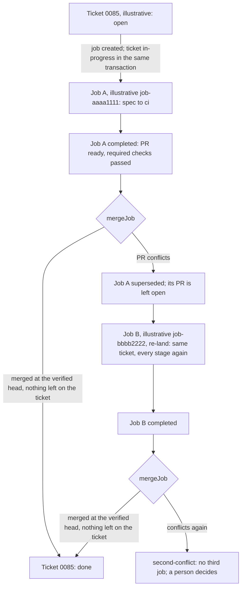

# Architecture: how it fits together

`orch` has three parts that hand work to each other: a **ticket queue** (what there is to do), the
**factory** (one attempt to do it, ending in a pull request whose checks pass), and the **merge**
(getting that pull request into the base branch and closing the ticket). This page explains the
architecture behind them: what `orch` controls and what Claude Code controls, where each piece of
state lives and which system is authoritative for it, how tickets and jobs relate, and how the
system recovers. It ends with how the ticket queue compares with
[Beads](https://github.com/steveyegge/beads), the issue tracker its model borrows from, and how
the merge and the unattended controller compare with agent-orchestrator and Gas Town.

The details live elsewhere: [tickets.md](tickets.md) for the queue,
[workflow.md](workflow.md) for stages, gates, and merging, [operations.md](operations.md) for
running and recovering it, [dashboard.md](dashboard.md) for the UI.

## Design principles

- **Deterministic core, agentic edges.** Workflow rules live in TypeScript and are tested; prose
  for Claude describes them second. A stage completes only when its required artifact exists,
  validates, and describes the commit that is still HEAD.
- **Evidence, not claims.** Verification is executed by `orch`, running commands from a policy the
  job did not write (the scripts and tests those commands run are the job's branch, so changes to
  them are labelled for review, not trusted); reviews are recorded against a clean commit; delivery
  ends with GitHub's verdict for the exact PR head. A draft PR is not "done" until its required
  checks pass, and a merged PR is not a closed ticket until the merged head is the verified one.
- **Merging is a person's decision, or an explicit opt-in.** The factory itself never merges and
  never force-pushes. A person merges on GitHub or with the dashboard's Merge; `orch job merge`
  and the controller merge only in a repository opted in with `orch factory config merge enable`.
- **Resumable from persisted state.** Jobs recover from the database, the artifact directory, and
  Git; never from a surviving conversation.
- **Local-first.** One developer, one machine, Windows first, cross-platform by default; the only
  runtime dependency is Drizzle over Node's built-in SQLite.

## Control plane and execution plane

`orch` is the **control plane**: the CLI, the dashboard, the SQLite database, the foreground
controller, and the gates. It selects work, decides which transition is legal, validates
artifacts, runs verification, reads GitHub, and merges. Claude Code is the **execution plane**:
the `/factory` skill, its subagents, and the isolated worktree they work in. It writes specs,
code, reviews, and decisions, and changes state only by calling `orch`.

| controlled by `orch`                                                       | controlled by Claude Code                                          |
| -------------------------------------------------------------------------- | ------------------------------------------------------------------ |
| the ticket queue, readiness, and the claim                                 | what the spec says, within the request                             |
| which stage a job is in and which transition is legal (`core/workflow.ts`) | the code, the commits, and the tests in the worktree               |
| whether an artifact is valid and registered against HEAD                   | the content of every artifact (spec, build, reviews, decision)     |
| running the verification policy and judging the run's validity             | which subagents it launches for the plan's step, and in what order |
| the job lease and owner token                                              | when its session ends                                              |
| pushing, the draft PR, reading CI, and merging                             |                                                                    |
| starting and stopping the controller's Claude child (`launchClaude`)       |                                                                    |

```
you
 ├─ orch ticket / orch ui              tickets, priorities, dependencies, human decisions
 └─ orch start | do | resume           foreground controller (src/ops/run.ts), one ticket at a time
      └─ claude -p "/factory <job>"    headless Claude Code child in the job's worktree
           ├─ orch factory next        the plan: step, agents and models, artifacts, exact commands
           ├─ orch job / worktree / verify / gh   one-shot CLI: open DB, one operation, exit
           │    └─ src/core (rules)  src/storage (SQLite)  src/ops (Git, GitHub, gates)
           └─ subagents (agents/*.md)  spec writer, challenger, builder, simplifier, reviewers, approver

/factory in any Claude Code session      the same loop, started by you instead of the controller
orch ui (optional, 127.0.0.1)            the same database: read models plus a few human actions
orch recover start (optional)            continues ci-stage jobs after a network outage
```

The controller does not implement a stage. For an agent stage it claims the job as `orch-runner`,
launches the skill, waits for the process to exit, and reads the job row. In `ci` it reads
GitHub's verdict with the same operation `orch gh ci` uses, because no agent is needed for that,
and a completed job goes to `mergeJob`. Every other rule is the one a session started by hand
meets.

## Sources of truth

| system                                             | authoritative for                                                                                                                                                                                                                                                    |
| -------------------------------------------------- | -------------------------------------------------------------------------------------------------------------------------------------------------------------------------------------------------------------------------------------------------------------------- |
| SQLite (`<data>/orch.sqlite`)                      | tickets, their links and history; jobs (stage, status, round and budgets, PR and CI fields, supersession); job events; artifact rows (path, hash, marker, HEAD); reviews; verification runs and checks; base-integration rows; leases (owner session, token, expiry) |
| GitHub                                             | PR state, required checks and their results for a head, mergeability, the merge and its merge commit                                                                                                                                                                 |
| runner files under `<data>`                        | `runner-lock/` (the controller lock, one generation file per session), `runner.json` (mode, scope, ticket, job, child PID, results, skipped tickets, how it finished), `runner.stop-next`, `runner.stop-now`                                                         |
| checkout claims under `<data>/checkouts/`          | which Claude Code session holds a checkout (the cooperative edit guard; see [workflow.md](workflow.md#checkout-ownership-cooperative))                                                                                                                               |
| artifact files under `<data>/jobs/<id>/artifacts`  | the content of specs, builds, reviews, decisions, verification logs, and saved CI logs; they count only as registered, and their hash is checked again at every gate                                                                                                 |
| Git (the job's worktree and branch)                | the code; every piece of evidence names the commit and tree it is for                                                                                                                                                                                                |
| Claude Code transcripts under `~/.claude/projects` | what a session and its subagents did; read-only, through the dashboard's Session tab, and never used to decide anything                                                                                                                                              |

Nothing is copied from one to another to be trusted later. `runner.json` repeats no job state:
everything `orch status` prints about the job is read from its row. GitHub's answer is read fresh
for every CI and merge decision.

## The three parts

| part    | unit   | answers                              | commands                                |
| ------- | ------ | ------------------------------------ | --------------------------------------- |
| Tickets | ticket | what is there to do, and what first? | `orch ticket ...`, `/log-todo`          |
| Factory | job    | is this change built and checked?    | `orch factory ...`, `/factory`          |
| Merge   | job    | is it in the base branch?            | `orch job merge`, the dashboard's Merge |

All three keep their state in one SQLite database in your user data directory. Nothing is written
into a repository, nothing synchronises, and nothing runs in the background unless you start the
dashboard or the recovery worker; `orch start` runs all three in the foreground, for as long as
that command runs.

- A **ticket** is a thing to do: a bug, a feature, a chore, or a question. It belongs to one
  repository, but the queue is global, so priorities and dependencies compare across repositories.
- A **job** is one attempt at a change in one repository. It may be linked to a ticket or stand
  alone. A ticket can have several jobs over time (a cancelled attempt, a re-land), but only one
  unfinished job at once.
- A **merge** is not a stage. A job is `completed` when its PR is ready and its required checks
  pass on GitHub; merging happens after that and is recorded on the completed job.

## Tickets and jobs

A **ticket** is the persistent description of what you want, and nothing about how an attempt is
going. Its fields (all in `src/core/tickets.ts`): a global id, a title, a Markdown body, the
repository, a status (`open`, `in-progress`, `done`, `dropped`, `duplicate`; blocked is derived,
never stored), a type (`bug`, `feature`, `chore`, `question`), an area, a priority (`P1`–`P4`), an
effort in days (`0.25`, `0.5`, `1`, `2`, `3`, `5`), dependencies, related tickets, `duplicateOf`,
and an append-only history ([tickets.md](tickets.md#fields)).

A **job** is one factory attempt at it in one repository: its stage and status, its artifacts, its
verification runs, reviews, and CI observations, its lease (who is working on it), its worktree
and branch, its base-integration records, its PR, and, after a merge, the merge evidence
([workflow.md](workflow.md)).



The ticket numbers and job ids above are illustrative, not from a real database. What the code
enforces about the relationship:

- **At most one unfinished job per ticket.** A partial unique index (`jobs_active_ticket_idx`)
  makes a second one impossible, whatever races; the claim runs in the job's insert transaction.
- **Supersession and re-land keep the same ticket.** A re-land job is linked to the ticket of the
  job it replaces, and the old job records `supersededBy`. Both keep their rows, events, and
  artifacts.
- **A completed job does not complete the ticket.** The factory completes before the PR is
  merged. Only a verified merge recorded by `mergeJob` (with no unchecked checklist item left) or
  an explicit `orch ticket done` closes it.
- **Why the split helps.** A ticket survives any number of failed, cancelled, or superseded
  attempts without losing its priority, dependencies, or history, so an interruption never loses
  the request, and the next attempt starts from the ticket rather than from a half-finished job.
  Each job keeps the complete evidence of one attempt, so an audit can see exactly which attempt
  was merged, at which head, and why the others were not.

## The life of a ticket

```
orch ticket add            ticket: open
        │
orch ticket ready          open, not a question, dependencies done, no unfinished job,
        │                  repository checkout present
        │
orch factory start         job created; in the same transaction the ticket becomes
  --ticket <id>            in-progress and is linked to the job (orch start and orch do
                           create it the same way, through orch factory dispatch)
        │
/factory                   spec → build → simplify → review → approve → pr → ci
        │                  every stage gated by orch on a validated artifact and a
        │                  verification run for the exact commit
        │
job completed              PR ready for review, GitHub's required checks passed on ciHead
        │                  the ticket is still in-progress
        │
orch job merge <job>       reads the PR fresh, merges exactly ciHead as a merge commit,
  or dashboard Merge       reads GitHub again to confirm, records the merge commit
        │
ticket: done               in the same transaction as the merge record, when the merged
                           head is the verified one and no `- [ ]` item is left
```

What can interrupt that path:

- **The PR conflicts with the base.** `orch job merge` creates one re-land job on the same ticket
  and marks the old job superseded. The re-land runs the factory again. If it conflicts too,
  nothing more is created and a person decides.
- **The ticket has unchecked checklist items.** The merge is recorded and the ticket stays
  in-progress, with the reason noted once. Tick what was delivered and run `orch job merge` again,
  or close it with `orch ticket done`.
- **GitHub merged a different head than CI passed on.** The merge is recorded as
  `verified: false`, the ticket stays open, and the command exits 1.
- **The repository is not opted in.** `orch job merge` refuses (`not-authorized`). The dashboard's
  Merge still works, because a click is a person's decision.

The `/dotodo` skill is this whole path as one instruction: start the factory for a ticket, tick the
delivered boxes, call `orch job merge`, and report. It adds no rules of its own.

## Who decides what

The split is the same in every part: rules that matter are TypeScript, checked in a database
transaction; Claude sessions do the creative work and call the CLI.

| decision                                | made by                                                                                                                                      |
| --------------------------------------- | -------------------------------------------------------------------------------------------------------------------------------------------- |
| which ticket to work on                 | the queue order, which you shape with priorities and dependencies: `orch start` takes the first ready ticket, or you name one with `orch do` |
| whether a ticket can have a job now     | `createJob`'s transaction and a unique index                                                                                                 |
| whether a stage is complete             | `orch`, from artifacts and verification runs                                                                                                 |
| whether the PR's checks passed          | GitHub, read by `orch gh ci` for the exact head                                                                                              |
| whether programmatic merging is allowed | you, per repository (`orch factory config merge`)                                                                                            |
| whether this PR may merge now           | `mergeDecision`, from the job and GitHub's fresh PR                                                                                          |
| whether the merge happened              | GitHub, read again after the merge command                                                                                                   |
| whether the ticket is done              | the merge transaction, or you with `orch ticket done`                                                                                        |

## Runner session state

The controller keeps exactly what it needs to continue after an interruption, outside the
database and with one writer per file (`src/ops/runner-state.ts`):

- **The lock**, `<data>/runner-lock/<n>`: a sequence of generations taken by exclusive file
  creation. The holder of the highest generation is the controller while its process is alive,
  started since the last boot, and its session record keeps beating. A starter that finds it
  stale creates the next generation, so of several starters exactly one wins.
- **The session record**, `<data>/runner.json`, replaced atomically: the mode (`queue` or
  `ticket`), the queue scope (one repository or all), the ticket `orch do` was given, the ticket
  and job in flight, the Claude child's PID and start time, the results so far, the tickets passed
  over with why, and, once the session ended on its own terms, when and why. An interrupted
  session has no `finished`, which is how `orch status` and `orch resume` recognise it.
- **Stop requests**, `<data>/runner.stop-next` and `<data>/runner.stop-now`, written by
  `orch stop next` and `orch stop`. A heartbeat can therefore never overwrite a stop.

What the controller did to a job is also recorded on the job itself as `runner.session` and
`runner.stopped` events, so it outlasts `runner.json`, which the next session replaces. Those
events are evidence; nothing decides from them
([operations.md](operations.md#runner-events-on-the-job)).

## Ownership and leases

A job has at most one owner. `orch job claim` (or `orch factory start`/`resume`) atomically takes
it and returns a token; the lease lasts 30 minutes by default and every successful mutation by
the holder renews it. There is no daemon renewing anything: a session that goes quiet lets its
lease lapse, and another session may then take over, which rotates the token so the previous
owner's commands fail with exit 4. The controller runs jobs as session `orch-runner`, and its
Claude child claims under the same name, so the child renews the controller's claim instead of
meeting a foreign lease. Whenever the controller leaves a job it releases it; a job another
session holds is left exactly as it is. Short operations (dashboard actions, `orch job merge`,
`orch job supersede`) claim for one episode and release. Checkouts have a separate, cooperative
lease for edits. Details: [workflow.md](workflow.md#ownership-and-resumability).

## Verification boundaries

What counts as evidence, and what does not:

- **The policy is the base's.** `orch verify` runs the `factory.json` at the merge base of the job
  branch: code the job did not write. A job's edit to it changes nothing until a person accepts
  it. The commands are argument arrays resolved on `PATH`; nothing from a title, description,
  issue, or the dashboard is executed.
- **Evidence is bound to a commit.** A run is valid only for the HEAD and tree it ran on, in a
  clean worktree, under the same policy fingerprint, with every required check passed. Gates
  recompute that at every step; no flag skips one.
- **Labels are not prevention.** Changes to tests, CI, dependencies, and the policy are labelled
  and must be named in the review and the PR, but the policy fixes which commands run, not what
  the job's scripts do.
- **CI is GitHub's.** The `ci` stage completes only on GitHub's passing verdict for the exact PR
  head, read by `orch`; a merge counts only at that head.
- **Isolation is advisory at the filesystem level.** `orch` refuses to count writes outside a
  clean worktree at a recorded HEAD as progress, but cannot stop a process from making them.

Details: [workflow.md](workflow.md#verification-evidence).

## Events and artifacts

Every accepted change appends a job event (`stage.started`, `artifact.registered`,
`verification.completed`, `ci.observed`, `pr.merged`, `runner.session`, ...) in the same
transaction as the change, so the event log is a complete audit trail of the job; tickets have
their own `ticket_events`. Artifacts are Markdown files under `<data>/jobs/<id>/artifacts`, plus
verification logs under `verification/<run>/` and saved CI logs under `ci/<sha7>/`. A file is
evidence only once registered: its row records the hash, the marker line, and the HEAD it
describes, and replacing registered content needs `--replace` and is logged with the previous
hash. `orch job events <id>`, `orch job show <id>`, and the dashboard's Events and Artifacts tabs
read them.

## Crash recovery and reconciliation

Nothing in `orch` holds state in memory that matters after the process ends. What survives a
crash is the database, the artifact files, Git, the runner files, and GitHub, and each recovery
path re-reads them rather than trusting what was in flight:

- **A job** resumes from its row: `/factory <id>` or `orch factory resume` takes over the lapsed
  lease, recreates a missing worktree on the surviving branch, re-verifies every registered
  artifact, and continues from the stage it was in. A `running` stage taken over becomes
  `interrupted` and must be explicitly restarted.
- **A base integration** left `started` is reconciled from Git on the next call: a half-done merge
  is aborted, a merge that completed but was never recorded is recorded, and nothing is blindly
  retried ([workflow.md](workflow.md#worktrees)).
- **A merge** is reconciled from GitHub: every call starts from a fresh read, so a timeout or a
  crash between GitHub's merge and the local write is finished by calling again
  ([workflow.md](workflow.md#verified-integration-and-reconciliation)).
- **The controller** is resumed with `orch resume`, which re-runs the ticket in flight from its
  durable state and refuses while the Claude child it started may still be alive
  ([operations.md](operations.md#stop-stop-next-and-resume)).
- **A `ci`-stage job** whose session died during a network outage can be continued by the opt-in
  recovery worker ([workflow.md](workflow.md#recovery-worker)).

## The dashboard

`orch ui` is a loopback-only view over the same database: the job board and job detail, the
Tickets section with the queue and each ticket's detail, a read-only factory status strip, and the
human decisions the workflow allows. It never starts, stops, or resumes the controller and never
messages a session. Details: [dashboard.md](dashboard.md).

## Compared with Beads

Beads (`bd`) is a dependency-aware issue tracker built for AI agents. `orch` took its model of
tickets, dependencies, readiness, and claiming from it, and none of its code. The exact functions
that were read are listed in
[decisions/2026-11-20-global-ticket-queue.md](decisions/2026-11-20-global-ticket-queue.md) (Beads
at commit `7862410`). The description of Beads below is from its README and docs as read on
2026-11-20; Beads changes quickly, so check it before relying on a detail.

### What is the same

| idea                                    | in Beads                                               | in orch                                                    |
| --------------------------------------- | ------------------------------------------------------ | ---------------------------------------------------------- |
| Work is a graph, not a list             | issues with typed dependencies                         | tickets with `ticket_links(ticketId, targetId, kind)`      |
| Only some links block                   | `blocks` and three others block; `related` etc. do not | `depends_on` blocks; `related` does not                    |
| Cycles are refused when a link is added | checked at write time                                  | `dependencyPath`, inside the write transaction             |
| "Ready" is computed                     | `bd ready`: no open blocking dependency                | `orch ticket ready`: the same, plus the conditions below   |
| Claiming is atomic                      | `bd update --claim` sets assignee and in-progress      | creating the job marks the ticket in-progress and links it |
| Every change is in a history            | an events table with old and new values                | `ticket_events` with `from` and `to`                       |
| The database is the source of truth     | the local Dolt database; JSONL is only an export       | the local SQLite database; there is no export              |

### What is different, and why

| topic             | Beads                                                                               | orch                                                                                           | why                                                                                                                                              |
| ----------------- | ----------------------------------------------------------------------------------- | ---------------------------------------------------------------------------------------------- | ------------------------------------------------------------------------------------------------------------------------------------------------ |
| Scope             | one database per project, in `.beads/`; cross-project links are an extra feature    | one queue for every repository on the machine                                                  | The question orch needs answered is "what next, across all my repositories", and one queue makes priorities and dependencies directly comparable |
| Where data lives  | in or beside the repository, shared through a Dolt remote (can be the git `origin`) | the per-user data directory; never in a repository                                             | orch is one person's machine. Nothing to sync means nothing to merge or conflict, and no ticket leaks into a shared repository                   |
| Storage           | Dolt, a version-controlled SQL database with cell-level merge                       | SQLite through Node's built-in driver                                                          | A single local writer needs transactions, not distributed merge. It is also the database jobs already use                                        |
| Ids               | hash ids (`bd-a1b2`), unique without coordination; `bd-a1b2.1` for children         | one counter (`0085`), never reused                                                             | Hash ids solve offline collisions between machines. With one database a counter is safe, shorter, and was already in use                         |
| Hierarchy         | epics, parent-child, up to three levels                                             | none                                                                                           | A ticket is sized to be one job. Bigger work is several tickets with dependencies                                                                |
| Dependency kinds  | four that block, several that annotate                                              | one that blocks, one that annotates, plus `duplicate`                                          | No second use yet for conditional or waits-for links                                                                                             |
| Blocked state     | maintained on the issue as a flag                                                   | derived on every read, with a reason per ticket                                                | The queue is hundreds of rows. Computing on read cannot go stale                                                                                 |
| Readiness         | no open blocking dependency (plus deferral)                                         | also: not a question, no unfinished job, repository checkout exists                            | Ready here means "a factory job could start now", not only "nothing blocks it"                                                                   |
| What a claim is   | an assignee and a status on the issue                                               | a job row; the job's lease is the worker's lease                                               | The job already records who is working and whether they are alive. A second claim mechanism would have to agree with it                          |
| Who does the work | not Beads' concern: any agent that reads `bd ready`                                 | the factory, with gated stages and executed verification                                       | orch exists to run and check the work. The tracker is one part of it                                                                             |
| Closing           | the agent runs `bd close`; "issue state is decoupled from code state"               | a verified merge closes the ticket in the transaction that records it, or you close it by hand | An agent saying "done" is a claim. orch closes on evidence: GitHub merged the commit its checks passed on                                        |
| Waiting on a PR   | optional gate issues (`gh:pr`, `gh:run`) that block other issues until resolved     | built in: the job's `ci` stage and `orch job merge`                                            | The PR belongs to the job, so its state is read for that job rather than modelled as another issue                                               |
| Multiple agents   | concurrent writers through a Dolt server; federation between machines               | one machine; SQLite immediate transactions and one unique index                                | Out of scope by design                                                                                                                           |
| Extras            | memory, compaction, messaging, formulas and molecules, GitHub/Jira/Linear sync      | none of these                                                                                  | Not needed to queue work for the factory                                                                                                         |

### The short version

Beads is a tracker you give to agents: it is distributed, lives with the project, and trusts the
agent to say when work is done. `orch`'s tickets are a queue for one person's factory: local,
global across repositories, and closed by proof of a merge. The graph model (typed links, cycle
checks, computed readiness, atomic claims, a history) is shared; almost everything about storage,
distribution, and what "done" means is not.

If you need tickets shared between people or machines, an issue hierarchy, or a tracker that works
without the factory, Beads is the better fit. `orch` does not try to cover that.

## Compared with agent-orchestrator and Gas Town

Two other projects run coding agents and get their work merged:
[agent-orchestrator](https://github.com/OrchestratorInc/agent-orchestrator) (AO) and
[Gas Town](https://github.com/gastownhall/gastown). `orch`'s merge took three ideas from them and
no code; the exact functions are listed in
[decisions/2026-11-20-orch-job-merge.md](decisions/2026-11-20-orch-job-merge.md). The controller
(`orch start`) took nothing from either: it was designed from `orch`'s own pieces, and this
comparison was written afterwards.

What follows is from their source as read on 2026-11-20, AO at commit `7919c96` (backend and docs
only) and Gas Town at `94cc822`. Both change quickly, so check them before relying on a detail.
One thing to know about Gas Town at that commit: its README and design docs describe a strict Go
merge engine (commit-pinned re-checks, a merge-slot lock, batch-then-bisect), and that engine is in
the tree, but nothing outside its own package and tests calls it. The path that runs is an agent
following a written procedure, and that is what the tables describe.

### What is the same

| idea                                         | in AO                                                                | in Gas Town                                                    | in orch                                                           |
| -------------------------------------------- | -------------------------------------------------------------------- | -------------------------------------------------------------- | ----------------------------------------------------------------- |
| One worktree and branch per unit of work     | a session's worktree                                                 | a worker's worktree                                            | a job's worktree                                                  |
| Merge only the commit that was looked at     | the caller's expected head against the stored, fresh, and CI heads   | proof afterwards that the target contains the submitted commit | `gh pr merge --match-head-commit <ciHead>`                        |
| Unknown is not ready                         | pending or unknown CI blocks; mergeability must be exactly mergeable | (no equivalent on the running path)                            | `UNKNOWN` mergeability is `waiting`, never a merge                |
| Prove the merge, then close the work         | (the provider's answer is taken as proof)                            | `gt mq post-merge`: prove, close the request, close the issue  | read the PR again; record and close the ticket only when `MERGED` |
| Every step tolerates "already done"          | a merge made elsewhere is picked up by the next poll                 | each close accepts an already-closed item                      | `already_merged` records what GitHub did and merges nothing       |
| The agent that merges never fixes a conflict | the owning worker is told to rebase                                  | the merging agent hands a task to a worker                     | a new job re-lands the work                                       |
| Uncommitted work is never thrown away        | a dirty worktree is not removed                                      | workers with uncommitted work are skipped on shutdown          | nothing in `ops/` deletes uncommitted work                        |

### Merging: what is different, and why

| topic               | AO                                                                                                           | Gas Town                                                                                                                         | orch                                                                                                                   | why                                                                                                                              |
| ------------------- | ------------------------------------------------------------------------------------------------------------ | -------------------------------------------------------------------------------------------------------------------------------- | ---------------------------------------------------------------------------------------------------------------------- | -------------------------------------------------------------------------------------------------------------------------------- |
| Who merges          | a person asks (the app, or `ao pr merge`); a ready PR only raises a notification                             | a dedicated agent session per repository, running `git` and `gh` itself from a written procedure                                 | one deterministic operation, `mergeJob`, behind the dashboard button, `orch job merge`, and the controller             | A rule that matters is enforced in code. An unattended run cannot wait for a click, and a procedure an agent reads is not a gate |
| Permission to do so | nothing merges automatically, so there is no setting                                                         | automatic once a repository is added; a required review is opt-in                                                                | off until `orch factory config merge enable` for that repository; a dashboard click needs no opt-in                    | "Humans merge" stays true everywhere the user has not said otherwise                                                             |
| Evidence required   | a fresh read of GitHub: checks passing for that head, no changes requested, no unresolved comment, mergeable | a rehearsal merge and the repository's commands, run locally by the agent, which may merge past a failure it judges pre-existing | the job completed on GitHub's passing verdict for one commit, after `orch` ran the checks and the reviews and approval | Evidence here is executed by `orch` and bound to a commit before the merge is even asked for; nothing is judged at merge time    |
| Merge method        | squash by default; merge or rebase on request                                                                | a merge commit pushed straight to the target branch; a PR merge only in its PR mode                                              | a merge commit of the PR, never squash or rebase                                                                       | The verified commit itself must end up in the base. A squash or rebase lands a commit nobody checked                             |
| After the merge     | the provider's response is recorded; a failed local write is repaired by the next poll                       | a deterministic command proves the commit is in the target, then closes                                                          | the PR is read again whatever `gh` exited with; one transaction records it and closes the ticket                       | A timeout after a successful merge is a success, and a crash before the write is repaired by calling again                       |
| A conflict          | the worker is messaged once to rebase; its branch goes on                                                    | a worker resolves on the same branch; its tests and the next rehearsal check it                                                  | one re-land job through every stage; the old job is superseded; a second conflict stops                                | A resolution is new code, so it gets the same specification, verification, and review, and it is bounded                         |
| Queue               | none; GitHub's compare-and-swap, and GitHub's merge queue for stacked PRs                                    | requests scored by priority and age, one merging agent per repository                                                            | none                                                                                                                   | The controller runs one ticket at a time and each merge is pinned at GitHub; a queue would guard nothing                         |
| The work item       | the tracker issue is never closed or commented on                                                            | the source issue is closed once the merge is proved                                                                              | the ticket closes only on a verified merge with no unchecked box left                                                  | Closing is a claim about the work, so it needs the same proof as the merge                                                       |

### Running unattended: what is different, and why

| topic                 | AO                                                                                                     | Gas Town                                                                                                            | orch                                                                                                                      | why                                                                                                                                  |
| --------------------- | ------------------------------------------------------------------------------------------------------ | ------------------------------------------------------------------------------------------------------------------- | ------------------------------------------------------------------------------------------------------------------------- | ------------------------------------------------------------------------------------------------------------------------------------ |
| What keeps running    | a daemon owned by the desktop app                                                                      | a daemon plus supervising agents that watch the workers and each other                                              | nothing: `orch start` is a foreground command and everything ends with it                                                 | One person's machine. A process the user started and can see cannot leave an agent working unnoticed                                 |
| How much at once      | many sessions; no overall limit found                                                                  | many workers; an optional scheduler caps them                                                                       | one ticket at a time                                                                                                      | Serial work means no merge queue, few conflicts, and one verification run at a time on a single machine                              |
| How a session starts  | an interactive terminal session, about fifty agent CLIs, `--permission-mode auto` unless set otherwise | an interactive tmux session, `--dangerously-skip-permissions` by default, the confirmation dialogs answered for it  | a headless `claude -p` child, `--permission-mode auto` with a short allow-list, never a bypass; Claude Code only          | Nobody is there to answer a prompt, so the session gets exactly what the factory needs and no more                                   |
| What decides a step   | an orchestrating agent, from its prompt                                                                | agents, from written procedures ("agent decides, Go transports")                                                    | `orch factory next` returns the step; transitions and gates are TypeScript                                                | A stage counts only when its artifact and evidence were validated by code, not when an agent reports it                              |
| Talking to a session  | CI failures, review comments, and conflicts are typed into the owning session                          | mail, and nudges typed into the session                                                                             | never; a session reads notices on its next `orch factory next`                                                            | Typing into a session is not something `orch` can do reliably, and a job must not depend on a message arriving                       |
| A failing check       | sent to the worker again for every new failure, without a limit                                        | the merging agent decides whether the branch caused it                                                              | one bounded re-run, then a recorded rework through build and review, limited by `maxCiRepairs`                            | A repair is new code and is reviewed; a budget turns an endless loop into a ticket that waits for a person                           |
| A quiet session       | left alone; an agent or a person interrupts or kills it                                                | flagged after 30 minutes without an update; dead workers are restarted; a stale supervisor is nudged, then replaced | left alone; only the process ending ends the wait, and two exits without progress stop the ticket                         | Silence is not evidence of failure: a builder or a test run can be quiet for a long time                                             |
| After a crash         | live sessions are adopted; dead ones stay stopped until a person resumes the same conversation         | a dead worker is restarted in its worktree and continues from its assigned work                                     | `orch resume` re-reads the ticket's jobs and starts a new session on the same job; refused while the old one may be alive | State is in the job row and its artifacts, not in a conversation, so any session can continue and only the stage in flight is redone |
| Stopping              | interrupt or kill one session                                                                          | stop everything, shut down with a grace period, or freeze every session in place                                    | `orch stop next` finishes the ticket in flight; `orch stop` ends the session and keeps the job                            | The useful stop for a queue is "after this one"; neither cancels work                                                                |
| Where a person stands | notified: needs input, ready to merge                                                                  | opt-in review and per-item flags                                                                                    | a `needs-human` stage that the job cannot leave by itself, and that stops the queue                                       | A decision that needs a person is a state the workflow enforces, not a notification that can be missed                               |

### The short version

AO is a desktop product for supervising many agent sessions at once: it watches GitHub, feeds
failures and review comments back into each session, and leaves the merge to a person. Gas Town is
a town of long-lived agents that assign, supervise, and merge each other's work, with a daemon to
keep them alive and deterministic commands at a few critical points. `orch` is neither: it is one
strict pipeline per ticket, where code decides every step and holds every gate, agents only do the
work inside a stage, and the merge is a checked operation rather than a judgement.

That buys evidence and predictability and gives up breadth. If you want many agents working at
once, agents other than Claude Code, a live view of every session, or review comments fed back to
the agent automatically, AO does that and `orch` does not. If you want a self-running system that
restarts and nudges its own agents and merges locally without a pull request, Gas Town does that
and `orch` does not.

## What is not built

Nothing picks a ticket and starts a job in the background: there is no background scheduler, no
daemon, and no merge queue. `orch start` selects tickets and runs them, but only in the
foreground, for as long as that command is running
([workflow.md](workflow.md#factory-controller)); otherwise each step above is one command that
someone, or a skill, runs. Nothing runs on the merged result either: "verified" means GitHub
merged the commit that passed its checks. The full list of deliberate boundaries is in
[operations.md](operations.md#intentional-limitations).
