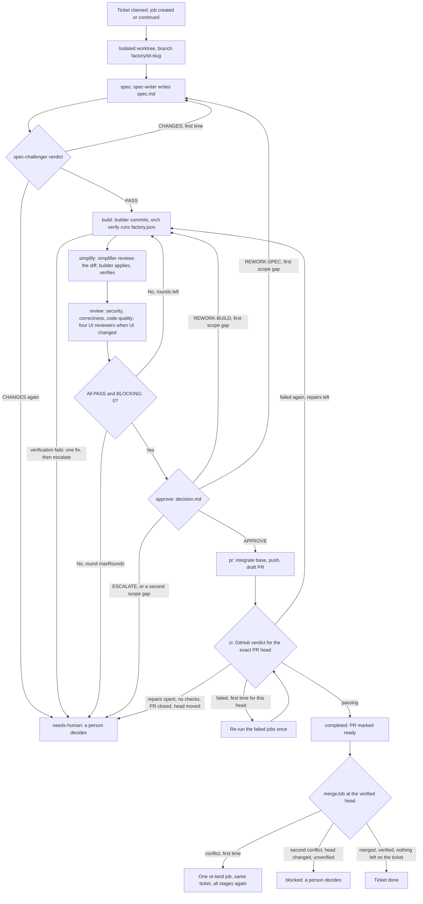

# Workflow internals

The rules `orch` enforces for a job, in detail. `README.md` gives the overview and
[overview.md](overview.md) the architecture; this file is the reference for stages, artifacts,
evidence, worktrees, GitHub, and ownership. [operations.md](operations.md) is how to run it.

## The ticket lifecycle end to end

How a ticket becomes merged software, in order. Each step links to its detailed rules.

1. **Creation.** `orch ticket add` (or the dashboard's New ticket) files a ticket in one
   repository with a global id, a type (`bug`, `feature`, `chore`, `question`), an area, a priority
   (`P1`–`P4`), an effort, and a Markdown body ([tickets.md](tickets.md#fields)).
2. **Priority and dependencies.** `orch ticket edit --priority` and `orch ticket dep add` shape the
   proposed order: dependencies first, then priority, effort, area, id
   ([tickets.md](tickets.md#order-and-readiness)).
3. **Readiness.** A ticket is ready when it is `open`, not a `question`, every dependency is
   `done`, no unfinished job is linked to it, and its repository checkout exists. Anything else is
   blocked, with a reason per blocker. In the controller's global queue a ready ticket of a
   repository without the merge opt-in is passed over.
4. **Claim.** Creating the job (`orch factory start --ticket`, `orch factory dispatch --ticket`, or
   the controller's dispatch) checks the ticket, marks it `in-progress`, and links it, in the
   transaction that inserts the job; a partial unique index allows one unfinished job per ticket
   ([tickets.md](tickets.md#tickets-and-jobs)).
5. **Job create or recover.** The controller (`runTicket`) continues the ticket's unfinished job if
   there is one, merges its last job if that one completed, and creates a job only for an `open`
   ticket. A cancelled job is never replaced automatically ([Factory controller](#factory-controller)).
   The job gets an isolated worktree on `factory/<id>-<slug>` ([Worktrees](#worktrees)).
6. **Specification.** `factory-spec-writer` writes `spec.md` (Goal, Scope, Acceptance criteria).
7. **Specification challenge.** `factory-spec-challenger` judges it against the request and the
   repository's conventions; one revision on `CHANGES`, and a second `CHANGES` escalates
   ([Spec challenge](#workflow)).
8. **Build.** `factory-builder` implements in the worktree and commits.
9. **Verification.** `orch verify` runs the repository's committed `factory.json` checks in the
   clean worktree and records the run for that exact commit
   ([Verification evidence](#verification-evidence)). `build.md` is registered against that HEAD.
10. **Simplify.** `factory-simplifier` lists over-engineering in the diff; the builder applies what
    makes sense, verifies again, and records each declined finding.
11. **Review.** `security`, `correctness`, and `code-quality` always review. `ui-design`, `ux`,
    `accessibility`, and `web-platform` join when the diff matches `uiPatterns` (by default
    `DEFAULT_UI_PATTERNS` in `src/core/roles.ts`: `.tsx`, `.jsx`, `.vue`, `.svelte`, `.astro`,
    `.html`, `.htm`, and style-sheet files, and images under `public/`, `static/`, or `assets/`). A
    consolidation records `BLOCKING: <n>` ([Review rounds](#workflow)).
12. **Rework.** Blocking findings or a `CHANGES` verdict send the job back to build, until a
    rejection in round `maxRounds` escalates. A scope gap at approval reworks once on its own.
13. **Approval.** `factory-approver` writes `decision.md`: `APPROVE`, `ESCALATE`, `REWORK-BUILD`,
    or `REWORK-SPEC`.
14. **PR.** The coordinator integrates the base, pushes the approved commit, and creates or reuses
    a draft PR ([GitHub integration](#github-integration)).
15. **CI.** `orch gh ci` reads GitHub's verdict for the exact PR head: completes the job on
    passing required checks and marks the PR ready, re-runs a failure once per head, then repairs
    through build within `maxCiRepairs`, or escalates ([CI reconciliation](#ci-reconciliation)).
16. **Merge.** `mergeJob` merges the PR at the CI-verified head as a merge commit and confirms it
    with a second read; a conflict becomes one re-land job ([Merging](#merging)).
17. **Settlement.** In the transaction that records the merge, the ticket becomes `done` only if
    the merged head is the verified one and nothing is left on the ticket
    ([Verified integration and reconciliation](#verified-integration-and-reconciliation)).
18. **Next ticket.** The controller first takes again an escalation a person has since decided,
    then continues a stranded in-progress ticket (its job released, pending or running, not
    waiting for a person), else takes the next ready ticket,
    passing over one it could not finish, or ends the run on an outcome that would hit every ticket
    ([Factory controller](#factory-controller)).

Any stage can escalate to `needs-human`, which waits for a person's decision
([operations.md](operations.md#resolving-needs-human)).



Every failure path ends in a bounded loop or with a person. Stages, who works in each, and what
`orch` requires before the next one:

| Stage      | Who                                                   | Produces                                                   | `orch` requires before the next stage                                                                                                                                                    |
| ---------- | ----------------------------------------------------- | ---------------------------------------------------------- | ---------------------------------------------------------------------------------------------------------------------------------------------------------------------------------------- |
| `spec`     | `factory-spec-writer`, then `factory-spec-challenger` | `spec.md`, `spec-review-N.md`                              | Goal, Scope, Acceptance criteria; the latest challenge says `VERDICT: PASS` for the current `spec.md`                                                                                    |
| `build`    | `factory-builder`                                     | commits, an `orch verify` run, `build.md`                  | clean worktree; a passing verification run for HEAD; `build.md` registered against that HEAD                                                                                             |
| `simplify` | `factory-simplifier`, then `factory-builder`          | `round-N/simplify-review.md`, fixes, `round-N/simplify.md` | both files registered; `simplify.md` against a clean, verified HEAD                                                                                                                      |
| `review`   | 3 reviewers (7 for UI changes)                        | `round-N/review-*.md`, `consolidated.md`                   | all three always-on verdicts recorded against the HEAD `simplify.md` (or, without one, `build.md`) describes, or one that follows it by clean base merges only; `BLOCKING: 0` to advance |
| `approve`  | `factory-approver`                                    | `decision.md`                                              | `DECISION: APPROVE` for the current HEAD; no blocking findings; verification still valid. A scope gap (`REWORK-BUILD`, `REWORK-SPEC`) goes back to `build` or `spec` once on its own     |
| `pr`       | the coordinator                                       | base integrated, pushed branch, draft PR                   | only clean base-integration merges since the approval; verified HEAD; policy unchanged                                                                                                   |
| `ci`       | the coordinator + `orch gh ci`                        | GitHub's verdict for the PR head                           | the job's own PR; checks passed for that commit, still the approved one (plus clean base merges)                                                                                         |

Default models per role: spec writer, builder, security reviewer, and approver Opus; spec
challenger, simplifier, and the other reviewers Sonnet. They are configurable in
`<config>/factory.json` (`models`).

## Workflow

```
spec → build → simplify → review → approve → pr → ci → completed
                            │  changes            │     │
                            └──────→ build        │     └─ (requires passing required checks for HEAD)
                            ▲                     └─ (requires a recorded PR)
                            ├── rework (base integration needs the builder) ── approve, pr, ci
                            ├── rework (CI failed, repairs < max) ── ci
         ▲                  └── rework (scope gap: DECISION: REWORK-BUILD, once per job) ── approve
         └── rework (scope gap: DECISION: REWORK-SPEC, once per job) ── approve
         any stage ── escalate ──→ needs-human ── resume --to <stage> ──→ back
```

That is the order for `verification.authority` `local` (the default). Under `ci`
([Verification authority](#verification-authority)) the same stages run in another order, with a
pr/ci pass before review:

```
spec → build → simplify → pr → ci → review → approve → pr → ci → completed
                          └ pre-review ┘                └ delivery ┘
```

### Fast jobs

A job's `mode` is `full` (the default, everything above) or `fast`, fixed when it is created.
Only `orch do <ticket> --fast` creates a fast job (decision 2026-11-23-fast-mode); `orch start`,
`orch factory start|dispatch`, the dashboard, and re-land jobs always create full ones. A fast job
is the same row, worktree, branch, lease, events, artifacts, PR, CI reconciliation, and `mergeJob`;
only its route differs, decided in the same `transition`:

```
build → pr → ci → completed          (under either verification authority)
  ▲      │    │
  └──────┴────┴── rework (CI failed, repairs < max; base integration needs the builder)
any stage ── escalate ──→ needs-human ── resume --to build | pr | ci | completed
```

- **One agent.** The build plan names only `factory-fast-builder`; no plan of a fast job names
  the spec writer, challenger, simplifier, a reviewer, or the approver.
- **The approved head is `build.md`'s.** `approvalEvidence(mode, artifacts)` in
  `src/core/workflow.ts` says which artifact is the approval: decision.md with
  `DECISION: APPROVE` for a full job, build.md for a fast one. Every reader of the approved head
  asks it: pr completion in `transition`, `requireApproved` in `src/ops/gates.ts` (and so push,
  `pr create`, pr and ci completion), `verifyOnDisk` in `src/storage/jobs.ts`, and the
  `integrations.decisionHead` column `integrateBase` writes (for a fast job it holds build.md's
  HEAD; the column keeps its name and is evidence only). The delivery rules are unchanged:
  HEAD contains the approved head, only clean base merges follow it, clean, verified, authorized
  policy. A fast job has no pre-review pass under `ci` authority: its CI verdict completes it.
- **The build gate refuses risk.** Completing a fast build is refused (exit 1, "Escalate") when
  `sensitiveReport` for HEAD shows a change of kind `policy` (factory.json or a file its commands
  run), `ci`, `test-config`, or `deps`, a deleted test file, a disabled or removed test, or policy
  drift. Renames count as a delete plus an add, so a file renamed out of its kind is still seen.
  Every delivery (push, `pr create`, pr and ci complete) repeats the check, so resuming past a
  refused build does not skip it. The same diff in a full job goes to the reviewers instead.
- **Resume limits.** `resume --to spec|simplify|review|approve` on a fast job is refused; to run
  the full workflow, cancel the job and `orch ticket reopen` the ticket (a new full job and
  branch; the fast branch is kept).
- **Measured.** `orch job usage` reports `mode`, each stage visit's duration, and `wallMs`.

**Stage** is where the job is; **status** is what is happening there:
`pending`, `running`, `blocked`, `interrupted`, `completed`, `failed`, `cancelled`.

Claude requests an action; `orch job transition <id> <action>` validates and applies it:

| Action     | Allowed when                                                                                | Effect                                                                                                                                                                       |
| ---------- | ------------------------------------------------------------------------------------------- | ---------------------------------------------------------------------------------------------------------------------------------------------------------------------------- |
| `start`    | status `pending`, `failed`, or `interrupted`                                                | status `running`                                                                                                                                                             |
| `complete` | status `running` and required artifact registered                                           | next stage, status `pending` (see below)                                                                                                                                     |
| `fail`     | status `running`                                                                            | status `failed`                                                                                                                                                              |
| `escalate` | any live stage                                                                              | stage `needs-human`, status `blocked`, remembers origin                                                                                                                      |
| `resume`   | `needs-human`, or status `interrupted`/`failed`/`blocked`                                   | back to the origin or `--to` stage, status `pending`                                                                                                                         |
| `rework`   | stage `approve`, `pr`, or `ci` (base integration needs the builder) or `ci` (checks failed) | stage `build`, status `pending`; re-review follows; a CI failure from `ci` counts a repair, or `needs-human` when `maxCiRepairs` is spent; base integration never counts one |
| `rework`   | stage `approve` with `decision.md` saying `REWORK-BUILD` or `REWORK-SPEC` (scope gap)       | stage `build` or `spec`, status `pending`; `scopeReworks` + 1; the second scope gap goes to `needs-human` instead                                                            |
| `cancel`   | any job not already finished                                                                | status `cancelled`                                                                                                                                                           |

`escalate` takes up to five `--choice "<kind>[:<stage>]=<label>"` values: answers a human can pick
in the dashboard's Choices block (decision 2026-11-23-needs-human-choices). `<kind>` is
`resume:<stage>` (spec through ci), `rework`, `review`, `accept-delivery`, `accept-policy`, or
`cancel`, the dashboard actions Resume at, Request rework, Request review round, Accept delivery,
Accept policy, and Cancel.
Labels are trimmed, non-blank, unique, at most 120 characters, and free of control characters; a
bad choice, or `--choice` on any other action, is a usage error (exit 2). The choices are kept on
the `job.blocked` event (`choices: [{ kind, to?, label }]`); only the newest `job.blocked` counts,
and only while the job is in `needs-human`, so escalating again replaces them. A fast job's
escalate is refused (exit 1, nothing written) when a `resume` choice names a stage outside build,
pr, ci, and completed: its mode never changes, so such a choice could never be answered.

Every `job.blocked` the transition writes records choices, with or without `--choice` (decision
2026-11-24-default-needs-human-choices): session and gate escalations, the review round limit, a
repeated scope gap, and the CI repair limit. `defaultChoices` in `src/core/workflow.ts` builds them
from the job and the reason: a stage the reason names (`resume --to <stage>`, `resume to <stage>`,
`resumes --to <stage>`, any case; `completed` is Accept delivery) first, then the return stage
("Send back to spec|build|simplify", "Retry review|approve|pr|ci"); Send back to build and Retry
review for the round limit; Accept policy for a reason naming the verification policy; Cancel
last. A fast job never gets a stage outside its resume targets. Recorded `--choice` values are kept
as given when one of them continues the job (`resume`, `rework`, `review`, `accept-policy`);
otherwise the default primary goes in front of them. `currentChoices` applies the same rule to an
older `job.blocked` that recorded none, so every job waiting in `needs-human` offers at least one
answer that continues it.

Required artifacts, relative to the job's artifact directory and registered with
`orch job artifact add`: `spec.md`, `build.md`, `round-N/simplify.md` (with
`round-N/simplify-review.md`), `round-N/consolidated.md`, `decision.md`, `pr.md`.
Registration checks the file is inside the artifact directory (no absolute paths or `..`), is
`.md`, exists, is non-empty, and has the structure its path requires (`src/core/artifact-rules.ts`):

| Artifact                     | Required headings                | Marker line (exactly once)                                        |
| ---------------------------- | -------------------------------- | ----------------------------------------------------------------- |
| `spec.md`                    | Goal, Scope, Acceptance criteria |                                                                   |
| `spec-review-1.md`, `-2.md`  | Findings                         | `VERDICT: PASS` or `CHANGES`                                      |
| `build.md`                   | Summary, Validation              |                                                                   |
| `round-N/simplify-review.md` | Findings                         |                                                                   |
| `round-N/simplify.md`        | Applied, Declined, Validation    |                                                                   |
| `round-N/review-<name>.md`   | Findings                         | `VERDICT: PASS` or `CHANGES`                                      |
| `round-N/consolidated.md`    | Findings                         | `BLOCKING: <count>`                                               |
| `decision.md`                | Rationale                        | `DECISION: APPROVE`, `ESCALATE`, `REWORK-BUILD`, or `REWORK-SPEC` |
| `pr.md`                      | Validation, Known limitations    |                                                                   |

Headings match case-insensitively at any level. The marker is stored on the artifact row and the
workflow reads it: `review record --verdict pass` is refused if the file says `CHANGES`, and
`approve` cannot complete unless `decision.md` says `APPROVE` (use `escalate`, or `rework` for a
`REWORK-*` decision, instead). Files with
other names (evidence, notes) are accepted without structure checks. A file on disk is not evidence
of completion until it is registered.

**Replacement is explicit.** Registering the same path with identical content is a no-op.
Registering changed content fails unless `--replace` is given, and is then logged as
`artifact.replaced` with the previous hash, so the history of what was accepted survives. Combine
with `--revision <n>` to also reject the replacement if the job moved on meanwhile. Review files are
per round (`round-N/`) and are never overwritten by later rounds.

**Spec challenge.** In `spec`, after `spec.md` is registered, `factory-spec-challenger` (an
independent subagent, Sonnet by default, role `spec-challenger` in `factory.json` `models`)
reviews it against the request and the repository's conventions and writes `spec-review-1.md`.
Registering a challenge is refused before `spec.md` is registered, and `spec-review-2.md` is
refused unless `spec-review-1.md` says `CHANGES`; no other `spec-review-N.md` is accepted. The
challenge row records the sha256 of the `spec.md` registered at that moment. `complete` from
`spec`, and `resume` from a `needs-human` that was escalated from `spec` to any other stage, are
refused unless the highest-numbered challenge says `PASS` and was bound to the `spec.md` registered
now; both also re-read `spec.md` and the challenge files, so an edited file is refused as changed
on disk.
On a first `CHANGES` the plan has the writer revise `spec.md` once (`--replace`) and a second
challenger run writes `spec-review-2.md`; a second `CHANGES` makes the plan `escalate`, keeping
the objections in the registered file. A challenge whose spec was replaced is challenged again
(`--replace` on the same file). The loop bound is the plan's, not a code cap; see
[the decision](decisions/2026-11-17-spec-challenger-gates-the-spec.md).

**Simplify.** Completing `build` increments the round and enters `simplify`, every time: the first
build, a review rework, a CI repair, and a base-integration rework. `factory-simplifier` (read-only,
Sonnet by default, role `simplifier`) reviews the job's diff for over-engineering and writes
`round-N/simplify-review.md`; then `factory-builder` applies the findings that make sense, commits
if anything changed, runs `orch verify`, and writes `round-N/simplify.md` with what it applied and
each declined finding with its reason. `simplify.md` is code evidence: it is registered only from a
clean worktree and records HEAD. `complete` is refused without both files, when HEAD moved past the
one `simplify.md` records, or without a valid verification run for that HEAD. A simplify that
changes nothing is valid; `simplify.md` then records the HEAD the build verified. Completing
`simplify` enters `review` in the same round; see
[the decision](decisions/2026-11-17-simplify-stage-before-review.md).

**Review rounds.** `resume` from `needs-human` into `simplify` or `review` opens a new round (a
requested re-review keeps earlier verdicts as history), while resuming an interrupted `simplify` or
`review` keeps its round. While `review` is
`running`, each reviewer is recorded with `orch job review record` (without a verdict while it
runs, then with `--verdict pass|changes`); the verdict is read from that reviewer's own
`round-N/review-<name>.md`. `complete` is refused while any reviewer is pending, until all three
always-on reviewers (`security`, `correctness`, `code-quality`) have a verdict (UI reviewers join for
UI changes), and when the verdicts describe a commit other than the one this round's `simplify.md`
was registered for (or, in a round with no `simplify.md`, such as a `request-review` or `resume --to
review`, the one `build.md` was registered for), unless the reviewed commit follows that one by
clean base merges only: it contains it, and every commit since then that is not on the base is a
merge whose result matches one of its parents (the rule delivery applies to the approval). Under
`ci` authority that is how a clean base merge in `pr`, between simplify and review, reaches
review without a rebuild. A commit of the job's own after `simplify.md`, or a merge with edits
inside it, is new code and is refused (decision
[2026-11-24-clean-base-merge-keeps-simplify-evidence](decisions/2026-11-24-clean-base-merge-keeps-simplify-evidence.md)). If every verdict is `pass` and `BLOCKING: 0`, the job moves to `approve`; otherwise the round is
a rejection and the job returns to `build`, unless the round is the last allowed one (`round >=
maxRounds`, from `--max-rounds`, default 3), in which case it escalates to `needs-human` with `max
review rounds reached`. Rounds that are not review-driven raise `maxRounds` by one instead of
spending it, recorded as `maxRounds` on the event: a base-integration rework (`job.reworked` with
`integration: true`, from `approve`, `pr`, or `ci`), a CI repair (`job.reworked` from `ci`; `maxCiRepairs` bounds those separately, and an
exhausted repair escalates without raising), and a human resume from `needs-human` to `build`,
`simplify`, or `review` (`job.resumed`; the dashboard's Request rework and Request review round are
such resumes). Every other resume raises nothing. So the board's `round / maxRounds` never shows a
round past its maximum.

**Scope gaps.** When the approver finds the build covers less than was asked, `decision.md` says
`REWORK-BUILD` (the code is less than the spec) or `REWORK-SPEC` (the spec is less than the
request), and `rework` from `approve` sends the job back on its own: to `build`, or to `spec` and
then `build`. Plain `rework` from `approve` is refused without one of those decisions (base
integration passes its own flag). The rework raises `maxRounds` like the others and counts on the
job's `scopeReworks`; with one already taken, the next `REWORK-*` moves the job to `needs-human`
(`returnStage` the requested stage, reason `scope gap found again after the automatic scope
rework`). Code cannot tell whether a second gap is the same one, so the bound is a count. A
registered `decision.md` records the hash of the `spec.md` registered at that moment; after a
`REWORK-SPEC`, `complete` from `spec` is refused while `spec.md` still has that hash, and the
challenge gate then requires a PASS for the revised spec. A human `resume` out of a spec
escalation to a later stage is refused the same way while `spec.md` still has that hash. Reviewers count a scope gap as BLOCKING,
which already sends the round back to build, and the spec challenger refuses a spec that drops part
of the request unless the request or a human excluded it; see
[the decision](decisions/2026-11-20-scope-gap-reworks-automatically.md).

**PRs.** `orch gh pr create` records the job's draft PR (created or reused); the `pr` stage cannot
complete without one, and completing it enters `ci`, which only `orch gh ci` completes, in the call
that read `ciStatus: passing` for `ciHead` from GitHub, after the gate confirms `ciHead` is still
the worktree HEAD. Pushing, PR creation, and completing `pr` or `ci` share one gate: HEAD is the
approved commit or adds only clean base-integration merges to it, is verified, and runs under an
authorized policy. A PR whose head branch or base branch is not the job's is escalated by `orch gh
ci`, never completed. When `orch gh ci` completes the job on a passing verdict it then runs `gh pr
ready` for an open draft (event `pr.ready` with the head, `ok`, and gh's error; `prState` becomes
`ready` on success). That step comes strictly after the completion commits, changes no stage,
status, or CI field, and is never retried: a failure is reported and a human runs `gh pr ready`.
The PR state can be updated later (ready → merged, `orch gh pr status`) without changing the
workflow. `closed` means GitHub reported the PR closed
without merging; it is recorded from `orch gh pr status` or `orch gh ci`, never inferred from the
job, and a job whose PR is `closed` can neither complete nor be accepted with `resume --to
completed`.

**Superseded jobs.** When a job is abandoned and started again, `orch job supersede <old> --by
<new> --session <name>` records the replacement on the old job (`supersededBy`, event
`job.superseded`). Both jobs keep their rows, events, and artifacts; nothing is merged or deleted,
and nothing is inferred from matching titles. The two must belong to the same repository and may
not form a loop. The command is a short ownership episode like a dashboard action: it claims the
old job for a minute, records, and releases, refusing (without `--force`) while another session
holds a live lease on it. `orch job show` lists the jobs a job replaced (`supersedes`), and the
dashboard links both directions.

Every accepted change appends events (`job.created`, `job.claimed`, `job.released`,
`stage.started`, `stage.completed`, `stage.failed`, `artifact.registered`, `artifact.replaced`,
`review.recorded`, `job.blocked`, `job.resumed`, `job.interrupted`, `job.cancelled`,
`job.completed`, `job.superseded`, `worktree.created`, `worktree.adopted`, `worktree.removed`,
`integration.started`, `integration.completed`, `verification.started`,
`verification.completed`, `verification.flaky`, `policy.authorized`, `job.reworked`, `branch.pushed`, `pr.recorded`,
`ci.observed`, `pr.ready`) in the same transaction. A `ci.observed` event from `orch gh ci` carries the head,
outcome, required-check list, every check's status and conclusion, and saved log paths.
`orch job events <id>` lists them.

**Usage.** `orch job usage <id>` reports what the records measure about where a job's time went:
wall-clock per stage visit (from `stage.started` to the event that ended it, with the review round
in effect), per reviewer run (from the pending record to the verdict), verification runs and their
check durations, CI repairs, re-runs, and observations, and the model the configuration assigns to
each role. It does not report tokens or money: Claude Code does not expose a subagent's token usage
or cost to the coordinating session or to `orch` through a supported interface, so the report says
`tokens.measured: false` with the reason rather than estimating (see decision 61).

## CI reconciliation

A draft PR whose checks fail is not a deliverable, so the `ci` stage exists to find out. The
coordinator runs `orch gh ci <id> --token <t>`, which reads from GitHub, for the PR's exact head
commit, the check runs and commit statuses plus the base branch's required-check configuration
(classic protection and rulesets), evaluates them with the pure rules in `src/core/ci.ts`, records
the observation on the job (`ciStatus`, `ciHead`, a `ci.observed` event listing every check), and
acts:

| GitHub reports (for required checks)                                                                             | `orch gh ci` does                                                                                                                                                                                                                                                                                                                                                                                                                                  |
| ---------------------------------------------------------------------------------------------------------------- | -------------------------------------------------------------------------------------------------------------------------------------------------------------------------------------------------------------------------------------------------------------------------------------------------------------------------------------------------------------------------------------------------------------------------------------------------- |
| all succeeded (at least one check ran; skipped/neutral alone never count)                                        | completes the job in the same call, once the gate confirms a clean, verified HEAD; `orch job transition complete` is refused in `ci`, so no stored verdict is ever reused                                                                                                                                                                                                                                                                          |
| any queued or running, or none reported yet (first 5 observations)                                               | nothing: the result says how long to wait (`waitSeconds`: 60 s for the first five observations of a head, then longer, at most 300 s); the coordinator sleeps and runs it again, or releases the job after 20 pending observations in one session (`plan.ci.release`) and resumes later; the CLI never polls by itself                                                                                                                             |
| `failure`, `timed_out`, `cancelled`, `startup_failure`, or `stale` on an Actions check, first time for this head | once every other required check has finished: `gh run rerun <run> --failed` (recorded as `ci.rerun`, bound to the head, at most one per head), then `wait`; no source changes, no repair spent. Until GitHub reports the new attempt the old runs are ignored for 5 observations                                                                                                                                                                   |
| `failure` or `timed_out` again for the same head (or the re-run could not be requested)                          | saves each failing Actions job log under `<artifactDir>/ci/<sha7>/`, then `rework`: back to `build` with the reason; `ciRepairs` + 1                                                                                                                                                                                                                                                                                                               |
| `cancelled`, `startup_failure`, `stale`, `action_required` again, or a required check that never reported        | `escalate`: not a code defect; a human re-runs the workflow and resumes `--to ci`                                                                                                                                                                                                                                                                                                                                                                  |
| no checks at all after the grace window, or only skipped ones                                                    | `escalate`: the factory does not invent success; a human adds CI (resume `--to ci`) or closes out with resume `--to completed`, which only this case and a merged PR allow                                                                                                                                                                                                                                                                         |
| PR merged (the job's own PR, head equal to the worktree HEAD), whatever the checks say                           | decided first, with no re-run, rework, or logs: when the delivery gate holds for that head, completes the job (with pending or failing checks the `job.completed` event records `mergedByHuman` and "merged by a human before CI finished"; passing checks complete as above); when it refuses, `escalate` with "PR merged by a human at <sha7>, but <refusal>". `orch gh pr status --token` on a running ci job that sees the merge does the same |
| PR head differs from the worktree HEAD or `origin/<branch>`                                                      | `escalate`: the branch changed outside the job; no verdict is borrowed from another commit                                                                                                                                                                                                                                                                                                                                                         |
| PR closed without merging                                                                                        | `escalate`; `prState` becomes `closed` (a cancelled job never implies a closed PR)                                                                                                                                                                                                                                                                                                                                                                 |
| `gh` or the API failed                                                                                           | exit 1, nothing recorded                                                                                                                                                                                                                                                                                                                                                                                                                           |

Without a configured required-check list every reported check counts as required; with one,
optional checks may fail. Either way the PR passes only when at least one check actually ran and
succeeded: skipped-only checks escalate even when a human made them required.
Check runs and statuses are read across every page (`gh api --paginate --slurp`, so `gh` 2.41 or
newer); a page that fails to load fails the whole observation rather than passing a partial list.
Runs with one name in one check suite are attempts of the same check (a re-run creates a new one in
the same suite) and only the newest counts; runs with one name in different suites, or whose suite
GitHub did not report, are independent checks and the worst one counts.
Private repositories on GitHub's free plan answer both configuration endpoints with HTTP 403, so
for them the list is always "unknown" and every reported check must pass.
A CI repair goes through the normal cycle: the builder gets the saved logs in its plan, commits,
`orch verify`, a new review round, a new approval, `orch gh push` to the same branch, and `orch gh
pr create` reuses the open PR. Repairs are bounded by `maxCiRepairs` (default 2, from the
orchestrator's `factory.json`; stored per job); when spent, the next failure escalates with reason
`max CI repair cycles reached`, keeping the PR and worktree. A job completes only when GitHub's
verdict for the current head is passing; `completed` therefore means "PR with passing required
checks, which orch marked ready for review" (or reported why it could not), never "PR created".
A human close-out (`resume --to completed`, the dashboard's Accept delivery) does not mark it ready.

Under `verification.authority: "ci"` a passing verdict before an approval holds for HEAD is the
pre-review pass: `orch gh ci` moves the job to `review` (event `stage.completed` with the head),
leaves the PR a draft, calls no `gh pr ready`, and the session keeps its lease. Failing,
infrastructure, `none`, outdated, and merged-by-a-human results act exactly as in the table, so
nothing short of a passing verdict for HEAD reaches review; a human merge before review escalates,
because the delivery gate still needs the approval. Only the pass after approval completes the job
and marks the PR ready.

## Recovery worker

Opt-in, never required (decision 2026-11-16-opt-in-recovery-worker). `orch recover run` repeats
passes in the foreground; `orch recover start` launches it detached and records its PID in
`<data>/recovery.pid`; `stop` ends it; `status` reports whether it runs and the last pass
(`<data>/recovery-status.json`). Each pass appends one line to `<logs>/recovery.log`.

A pass first probes GitHub (`gh api rate_limit`). While the probe fails it changes nothing and the
next pass backs off from 30 s, doubling, to 10 min. Otherwise every unfinished job is classified
(`src/core/recovery.ts`):

| Class           | When                                                                                              | The pass                                  |
| --------------- | ------------------------------------------------------------------------------------------------- | ----------------------------------------- |
| `human`         | `needs-human`, blocked, failed, cancelled, completed, archived, superseded                        | nothing                                   |
| `active`        | another session holds a live lease                                                                | nothing (never `--force`)                 |
| `exhausted`     | 5 consecutive `recovery.failed` for the current CI head                                           | nothing; reported with the resume command |
| `recoverable`   | `ci` stage, PR recorded, no live lease (none, released, lapsed), pending, interrupted, or running | one episode as `orch-recovery`            |
| `needs-session` | any other stage (`spec` to `pr`, or `ci` without a PR) with no live owner                         | nothing; reported with the resume command |

The episode: `orch factory resume` (claim, rotate the token, interrupted work back to pending,
worktree kept), `start` unless the job is still running, one `orch gh ci`, then release unless
that call finished the job. It logs `recovery.attempted`; an error logs `recovery.failed` with the
reason and releases, so the next pass or a human can pick the job up. The fifth consecutive failure
for the same head escalates to `needs-human` with `recovery retries exhausted: <last error>`. A
claim by any other session resets the count. After a successful probe the next pass waits the
smallest CI `waitSeconds`, at least 60 s. The worker never launches, resumes, or messages a Claude
session and never removes a worktree. Before every pass and every episode the worker checks that
`recovery.pid` still names it; once another worker has taken the file it stops and writes nothing
more (decision 2026-11-24-recovery-worker-checks-its-pid-file).

## Factory controller

Opt-in, foreground, and gone when its command exits (decision
2026-11-21-foreground-factory-runner). `orch start` works the ready queue, `orch start repo` only
the repository of the current directory, `orch do <ticket>` one ticket, `orch resume` an
interrupted session. One controller per installation; a second start is refused.

For each ticket, `runTicket` (`src/ops/run.ts`) reads the ticket's jobs and takes the first row
that applies:

| The ticket has                                       | The controller                                                                                   |
| ---------------------------------------------------- | ------------------------------------------------------------------------------------------------ |
| status `done`                                        | reports it done                                                                                  |
| an unfinished job                                    | continues that job                                                                               |
| status `open`, no unfinished job                     | creates a job (`dispatchJob --ticket`, fast under `orch do --fast`), if merging is enabled there |
| status `in-progress`, last job completed             | merges it (`mergeJob`), which also records a merge already made                                  |
| status `in-progress`, last job cancelled             | stops: a cancelled job is never replaced (`orch ticket reopen`)                                  |
| a blocked dependency, a question, a missing checkout | refuses with the ticket's own block reasons                                                      |

`orch do <ticket> --fast` is kept in the session record, so `orch resume` keeps it; it applies
only when the controller creates the job for that ticket. An unfinished job continues in its own
recorded mode, and the controller logs one line saying `--fast` did not apply.

A job runs as session `orch-runner`. In an agent stage the controller claims it, makes sure the
worktree exists, attaches a fresh `claude-code` session id to the job, and starts
`claude -p "/factory <job>" --output-format stream-json --verbose --session-id <id>` there with
`ORCH_SESSION=orch-runner`. Each step the child reports (text, tool call, result) is one short
`claude:` line on the controller's stderr, the child's stderr passes through as it comes, and the
Session tab reads the transcript of that id (decision 2026-11-23-live-claude-output). When the
process exits it reads the job row, whatever the exit code. In `ci` with a PR it reads
GitHub itself with `orch gh ci`'s operation, sleeping the returned `waitSeconds` between reads, and
starts a session again only if the verdict sent the job back to build. A job in `needs-human` or
cancelled ends the ticket. A completed job goes to `mergeJob`:

| `mergeJob` says                                    | The controller                                    |
| -------------------------------------------------- | ------------------------------------------------- |
| `merged` / `already_merged`, verified, ticket done | the ticket is done; next ticket                   |
| the same, not verified, or the ticket stays open   | blocked (unchecked boxes are named)               |
| `reland`                                           | runs the re-land job the same way, then merges it |
| `waiting`, `error`                                 | five attempts in total, 30 s apart                |
| `blocked` (second conflict, head changed, refused) | blocked, with the code and reason                 |

Budgets: two sessions in a row that exit without changing the job's stage, round, CI repairs, or
artifacts; 60 CI reads; five unreadable answers from GitHub. A ticket that ends blocked, refused,
or waiting for a person ends only `orch do`: in queue mode the controller releases its job,
passes the ticket over for the rest of the session (`orch resume` included), takes the next ready
ticket, and lists it with the reason and its next step in the end-of-session summary. One
passed-over ticket is taken again in the same session (`orch resume` included): an escalation
(code `needs-human`) whose job a person has since moved on, out of `needs-human`, not cancelled,
and with no live lease. It is checked before each stranded or ready ticket and once more before the
session ends; Accept delivery leaves the job completed, so the retake merges it. A completed job
whose merge only a person can make is not taken again: Merge on the dashboard completes the ticket
by itself (decision 2026-11-24-default-needs-human-choices). Only an
outcome that would hit every ticket ends the whole session there: `claude-failed`, `usage-limit`
(left unfinished, so `orch resume` continues the same ticket),
`github-unreadable`, `merge-no-answer`, or `github-refused` (`RUN_ENDING_CODES` in
`src/core/workflow.ts`; any other code continues, decision
2026-11-23-queue-ends-only-on-run-wide-outcomes). For `ticket-open` (merged and verified, a box
left unchecked) the next step is to tick or move the remaining boxes, then
`orch ticket done <id>`. Exit status is 1 in every such case.
The budgets are counted in the running controller only: `orch do` or `orch resume` starts them
again, which takes a person each time. Nothing waits between two sessions, and nothing ends a
session for running long. Every budget, durable or controller-local, is in one table in
[operations.md](operations.md#recovery-budgets).

What the controller did is also written to the job's own events, as `orch-runner`, so it outlasts
`runner.json` (which the next session replaces) and shows in `orch job events`, the dashboard's
Events tab, and, for a stop, the status mail (decision 2026-11-21-runner-evidence-on-the-job):

| Event            | Written                                                                    | Payload                                                                                                                                                                                        |
| ---------------- | -------------------------------------------------------------------------- | ---------------------------------------------------------------------------------------------------------------------------------------------------------------------------------------------- |
| `runner.session` | each time a Claude process the controller started has ended                | `outcome` (`exited` on its own, `stopped` by `orch stop`, `failed` to start), `exitCode`, `signal`, `error`, `pid`, `seconds`, `moved`, `stage`, `status`, `sessionId`, `stderrTail`, `result` |
| `runner.stopped` | when a ticket ends `blocked` or `needs-human` and its job is not cancelled | `outcome`, `code`, `reason`, `stage`, `status`, `next` (the command that continues it)                                                                                                         |

`exited` with `exitCode` 0 says only that the process ended; `moved` says whether the job's
stage, round, CI repairs, or artifacts changed during it. `runner.stopped` describes the
controller, not the job: the job keeps the stage and status it had, and `code` says what stopped
the ticket: `no-progress`, `claude-failed`, `usage-limit`, `ci-pending`, `github-unreadable`, `needs-human`,
`unverified-merge`, `ticket-open`, `reland-refused`, `merge-no-answer`, `ownership` (another
session held the job), `error` (any other `orch` refusal), any `mergeJob` block code
(`MERGE_BLOCKS` in `src/core/workflow.ts`, listed under [Merging](#merging)), or `merge-blocked`
when `mergeJob` blocked without a code. A stop on request (`orch stop`, `orch stop next`, Ctrl+C)
writes no `runner.stopped`, and neither does a cancelled job. Asking again when nothing happened
since (the same code and reason are the job's last news) adds no second one. What each code
means and how to act on it: [operations.md](operations.md#runner-events-on-the-job).

Whenever the controller leaves a job it releases it, a job waiting in `needs-human` included, even
when the session that escalated exited without releasing. It records and releases only a job it
holds or nobody holds: a job another session holds is left exactly as it is, with nothing written
to it. A person then decides a `needs-human` job on the dashboard (Approve to a stage, Request
rework, Request review, Accept policy, which also returns the job to the stage it was escalated
from unless that is spec, Accept delivery, Cancel) and runs `orch do <ticket>`, which
continues the same job; `orch start` afterwards goes on with the queue. Deciding with
`orch factory resume <job> --to <stage>` instead works the same way: it gives the job up again at
once (`token: null`, `--release` is redundant but accepted), so `orch do` can continue it. To continue a spec the challenger rejected twice, edit
`<artifactDir>/spec.md`, choose Resume at spec (or `orch factory resume <job> --to spec --release`),
and run `orch do <ticket>`: after a human resume to spec, a spec.md that differs from its
registered content is registered by the next plan and challenged again.

`orch stop next` is read at the ticket boundary. `orch stop` (or Ctrl+C) terminates the Claude
process the controller started, releases the job in the state it was in, and leaves the session
for `orch resume`; with no controller alive it discards an interrupted session instead. Neither
cancels anything.

State lives in `<data>/runner-lock/` (one small file per session; the highest number is the
current lock), `runner.json`, `runner.stop-next`, and `runner.stop-now`.
`runner.json` holds what the session was asked to do and which ticket, job, and child PID are in
flight; everything else `orch status` prints is read from the job row. After a crash,
`orch resume` re-runs `runTicket` for the ticket in flight, which continues the same job or
finishes the same merge, and then goes on as the session was configured. It refuses while the
recorded child PID is alive and is still the child: `childIdentity` (`src/ops/runner-state.ts`)
reads the OS start time of the process at that PID (`processStartMs` in `src/core/exec.ts`:
`Win32_Process.CreationDate` on Windows, `ps -o lstart=` elsewhere) and compares it with the
recorded `startedAt`. Inside the window (10 s before to 60 s after) it is the original child and
resume and `orch stop` refuse; outside it the PID was reused and they go ahead. When the start time
cannot be read (unsupported, error, timeout) the answer is unknown and they refuse. The refusal
names the PID, the recorded start, and an inspect command: end the process yourself if it is
Claude and rerun, or use `--force` only if it is another program. `orch` never signals or adopts
it. `orch status` and the dashboard keep the cheap PID-and-boot check, so they may still say "may
still be running" for a reused PID. `orch start` and `orch do` refuse while an interrupted session
exists.

A live controller can look dead: after the machine sleeps past the stale threshold its heartbeat
is old until the next beat, and a starter in that window takes the next generation. So the holder
checks its own lock before every write and every job step (runner state, claim, release, event,
transition, CI read, merge, dispatch, launch). A controller that finds a higher generation than
its own stops at once: it kills the Claude process it started, waits for it to exit, writes
nothing more, and exits 1 with "Another factory controller took the lock". The job keeps its
`orch-runner` lease for the controller that has the lock, and `orch resume` continues the session
(decision 2026-11-21-controller-checks-its-lock).

Tickets passed over for a missing merge opt-in are part of the saved session: `orch resume`
continues that session and keeps skipping them, also after
`orch factory config merge enable` for their repository. A new session reconsiders them: let the
session end (or discard an interrupted one with `orch stop`), then `orch start` again.

### Claude Code configuration

The controller starts the `claude` it finds on PATH, with the prompt and the permission rules as
separate arguments. That needs a real executable: on Windows a `claude.cmd` or `.bat` shim (what
an npm global install provides) is started by `cmd.exe`, which parses its command line as text,
and a multi-line prompt and rules such as `Bash(orch *)` cannot be passed through it safely. Such
a shim is refused before anything starts. Install the native build (`claude.exe`) and put it
first on PATH (`orch doctor` checks that a `claude` is found). It must be signed in (run `claude`
once), and the `factory` skill and agents must be installed (`orch install`).

The session's permissions are `runnerClaudeArgs` in the user's `<config>/factory.json`. The
default is what a Node repository's factory run needs:

```json
{
  "runnerClaudeArgs": [
    "--permission-mode",
    "auto",
    "--allowedTools",
    "Bash(orch *)",
    "Bash(git *)",
    "Bash(npm *)",
    "Bash(npx *)",
    "Bash(node *)",
    "Bash(cd *)"
  ]
}
```

A repository whose builder runs other tools should have them added. A command outside the list
is left to auto mode's judgement, and in a headless session nobody is there to approve one it
declines, so the job can stop moving. For example `"Bash(pnpm *)"`, `"Bash(cargo *)"`,
or `"Bash(pytest *)"`. The setting replaces the default list, so repeat the entries you still
want; it applies to every repository the controller works on, and it is never read from a
repository. `orch verify` runs a repository's own checks whatever is listed here: the allow-list
is only about what the agents may run while they work.

## Session notices

A running session is never messaged; it learns of outside events on its next `orch factory
next|status` (decision 2026-11-19-session-notices-are-pulled-on-next). `plan.notices` lists them,
and the text output prints them as a `Notices:` block above `Next:`:

| Kind           | Shown while                                                            |
| -------------- | ---------------------------------------------------------------------- |
| `base-moved`   | the worktree is behind its base ref (unfinished, not `needs-human`)    |
| `pr-merged`    | `prState` is `merged`                                                  |
| `cancelled`    | the job has a `job.cancelled` event (who and why, from that event)     |
| `fetch-failed` | `next`/`status` tried to fetch `origin/<base>` and failed (15 s limit) |
| `message`      | a `notice.posted` event newer than the largest acknowledged `through`  |

`next` and `status` call `planJobFresh`, which fetches the base branch into the job's repository
first when the job is unfinished, has a worktree, and has an `origin`; the dashboard, mail, and the
recovery worker call `planJob`, which never fetches, so their `base-moved` uses the last fetched
ref. In `review`, `base-moved` says to integrate after the round completes.

`orch job notice post <id> --message <m> [--by <name>]` posts a message without a token (actor
`human` by default, at most 100 characters; text at most 2000 characters; control characters and
line breaks become spaces; refused on a completed or cancelled job). It changes
no revision or lease. `ops/actions.ts` `postNotice` is the one write path, for the dashboard's
prompt box later. The owner acknowledges with `plan.noticeAck`
(`orch job notice ack <id> --through <event-id> --token <t>`), which records `notice.acked`;
`through` must be one of the job's `notice.posted` events. Event ids are global and increasing, so
acknowledging an older id after a newer one never brings a message back. `plan.commands` never
carries the ack; `plan.noticeAck` is null when nothing is unacknowledged or the job is finished.

## Status mail

Optional (decision 2026-11-17-mail-reports-built-in-smtp-client; settings in
[operations.md](operations.md#email-reports)). `src/integrations/mail.ts` is the generic sender: config from `<config>/mail.env` and
`MAIL_*`, and a `node:tls` SMTP client (implicit TLS, AUTH PLAIN or LOGIN, one base64 UTF-8 text
part, no retry). `orch mail report` exposes it without opening the database.

Job reporting lives in `src/ops/mail.ts`. The CLI (`job`, `factory`, `worktree`, `gh`, `verify`),
the dashboard action route, and each recovery-worker pass take a watermark (the highest event id)
before the operation and call `reportJobMail` after it, also when it threw. For every job with
`REPORTED_EVENTS` (`src/core/mail-report.ts`) after `max(job.mailCursor, watermark)`:

1. claim: one immediate transaction moves `jobs.mailCursor` to the batch's last event id only if
   it still holds the value read, so concurrent processes send a batch at most once;
2. compose: subject `<prefix> <id>: <title>` (kept in `mailSubject` from the first send) and a body
   with an outcome emoji, status, and stage on its first line (the inbox preview), every `STAGES`
   entry marked done, current (with the outcome emoji), or pending, the PR, each event prefixed by
   its kind's emoji with its `reason`, and the status command. The emoji table is in
   `src/core/mail-report.ts`; the subject carries none, because a changing subject splits the thread;
3. send, as a reply to `mailLastId` with `References: <mailThreadId> <mailLastId>` once a thread
   exists;
4. record `mail.sent` (`messageId`, `inReplyTo`) and the thread ids, or `mail.failed` (`error`,
   never credentials).

Mail columns and events are metadata: no owner check, and `revision`, `updatedAt`, and the lease
are untouched, so an owner's `--revision` guard never sees them. A failure is never retried (the
claim already moved the cursor) and never changes the command's output or exit code; text mode
adds one stderr line `orch: mail report for <id> failed: <message>`. Without configuration the hook
only reads the watermark. Events written outside these hooks are not caught up later: the next
report starts after its own watermark. A job created before mail was configured starts its thread
at its first reported change afterwards.

## Worktrees

Each job gets one isolated Git worktree and branch, created from the job's base branch:

```sh
orch worktree create <id>            # <data>/worktrees/<repo slug>/<id>, branch factory/<id>-<title slug>
orch worktree show <id>              # branch, HEAD, dirty files, commits and changed files vs base
orch worktree adopt <id> --path <d>  # record an existing worktree of the same repository instead
orch worktree integrate <id>         # merge origin/<base> (or local base) into the job branch
orch worktree remove <id> [--repo <clone>]  # delete the directory; refused while dirty; branch kept
```

- Worktrees live under the runtime data directory, never inside a project checkout, and many
  repositories and jobs coexist (`worktrees/github.com-acme-alpha/job-1a2b3c4d`).
- `create` is idempotent: an existing worktree on the right branch is confirmed, a directory that
  vanished is recreated on the surviving branch, and a foreign directory at the path is an error.
  The checkout used is the job's recorded `repoPath` (or `--repo <other clone>`). The job's own
  repository is recognised by its Git common directory (so the checkout and every linked worktree
  qualify, whatever happened to `origin` since); another clone qualifies only when its `origin` is
  the job's recorded identity.
- `adopt` validates that the directory is the top level of a worktree of the same repository, on a
  branch, and not the primary checkout. Two jobs can never share a worktree or a branch; the
  database refuses it.
- `remove` and `integrate` refuse to run over uncommitted changes; `integrate` aborts cleanly on a
  conflict and reports the files, leaving the worktree exactly as it was. The branch and its
  commits are always preserved; `orch` never deletes uncommitted or unpushed work.

**Base integration** records an `integrations` row before Git runs (job HEAD, base ref and SHA,
merge base, the approval commit, the valid verification run) and completes it afterwards (result
HEAD, conflicts, files changed by taking the base, and `material`: files whose merge result matches
neither parent, from `git diff-tree --cc`). Outcomes: `up-to-date` (no commit), `merged`, `conflict`
(merge aborted), `interrupted`. In the `approve`, `pr`, or `ci` stage a conflict, or a merge with
material edits, moves the job back to `build` (`rework`): the builder merges and resolves, and the
result is verified, reviewed, and approved again. A clean merge only needs a fresh `orch verify` on
the new commit, except in `ci`, where it reworks too: only the `pr` stage pushes, so the new head
comes back through verification, approval, and `pr` to the same PR. Under `ci` authority a clean
merge in the pre-review `pr` pass keeps `simplify.md` valid: review judges the merged head, which
follows the simplified one by that clean merge only. A base-integration rework never
spends a CI repair (a base conflict is not a CI failure), so a job whose repairs are exhausted still
goes to `build`. A completed job cannot rework; the dashboard's Fix merge conflicts re-lands it as a
new job instead (`docs/dashboard.md`).
On resume, a row left `started` is reconciled from Git: a half-done merge (`MERGE_HEAD`) is
aborted, a merge that completed but was never recorded is recorded, anything else is marked
interrupted; the merge is never blindly retried. Delivery (`gh push`, `gh pr create`) then requires
that every commit since the approval is a merge with no material edits, that the policy has not
drifted without authorization, and that the latest verification run is valid for the pushed HEAD.

- `create`, `adopt`, `remove`, and `integrate` require the job's owner token; `show` is read-only.
- A job created from a linked worktree (`orch factory dispatch`, `orch factory start`, or
  `orch job create`, with `--repo` or the current directory inside it) records the primary
  checkout as `repoPath`, and without `--base` the primary checkout's current branch as its base,
  so that worktree stays adoptable (`jobRepository` in `src/ops/repo.ts`).

**Ownership is advisory at the filesystem level.** The CLI enforces that only the owner records
changes about a job, but any process with filesystem access (including a subagent pointed at the
wrong directory) can write into another job's worktree, the initiating checkout, the artifact
directory, or the SQLite file itself. What the CLI can do is refuse to count such writes as
progress: evidence is accepted only from a clean worktree at a recorded HEAD, re-hashed at every
gate, and the plan reports dirty files in both trees. Skills pass the worktree path explicitly to
every subagent. A worktree on the base branch, or inside the initiating checkout, cannot be adopted.

## GitHub integration

`orch gh` wraps the GitHub CLI (`gh`, authenticated with `gh auth login`). No GitHub SDK, no
tokens handled by `orch`.

```sh
orch gh repo [--repo <path>]            # nameWithOwner, default branch, identity for a checkout
orch gh issue <#N|N|url> [--repo <path>]
orch gh push <id>                       # git push --set-upstream origin <job branch>; never force
orch gh pr create <id> --body-file <md> [--title <t>]   # draft PR, or the existing open one
orch gh pr status <id>                  # state, draft/ready/merged/closed, CI rollup; recorded with --token
orch gh ci <id> --token <t>             # ci stage: GitHub's verdict for the exact PR head, acted on (see above)
```

Before pushing or creating a PR, `orch` checks that the job is in the `pr` stage, that
`decision.md` is a registered `APPROVE` tied to a commit, that every commit since that commit is a
base-integration merge (`rev-list --no-merges <approved>..HEAD ^<base>` is empty), that the job
branch is not the base branch, that GitHub's repository for the checkout matches the job's
identity, that the base branch exists on `origin`, and (for the PR) that `origin/<branch>` equals
the worktree HEAD. An open (or merged) PR for the
branch with the same base is reused instead of creating a duplicate. The PR is recorded on the job
(`prUrl`, `prState`) together with the CI rollup (`ciStatus`: `none`, `pending`, `passing`,
`failing`) but no head (`ciHead` is written by `orch gh ci` alone). `orch` never force-pushes, and marks the
PR ready only after `orch gh ci` completes the job; a recorded draft PR is not a passing CI run, which is what the `ci` stage then establishes.
Merging a completed job is `mergeJob` ([Merging](#merging)), not the factory session: a dashboard
Merge click, or `orch job merge` and the controller where the repository is opted in to
`mergeRepos`. After completion, `prState` (`draft`, `ready`, `merged`, `closed`) changes
only from GitHub's answer: `orch gh pr status <id> --token` and the dashboard's Refresh PR record
`prState` alone (event `pr.observed`) and keep the completed verdict's `ciHead` and `ciStatus`; a
merge is never inferred.
`orch gh ci` reads check runs and statuses with `gh api` for the head SHA (not the PR rollup), the
base branch's protection and rulesets for the required list, and Actions job logs for failures.

Tests never call GitHub: setting `ORCH_GH_SHIM=<file.cjs>` makes `orch` run `node <file> <args>`
instead of `gh`, and the suite uses a stateful shim plus a local bare repository as `origin`.

## Merging

A completed job is not a merged one, and a merged PR is not a closed ticket. Merging is one
operation, `mergeJob` in `src/ops/merge.ts`, reached by the dashboard's Merge and by:

```sh
orch job merge <id> [--json] [--session <name>] [--force]
orch factory config merge enable|disable|status [--repo <path>]
```

**Authorization.** A click on the dashboard's Merge is a human's decision and needs nothing else.
`orch job merge` is refused (`blocked`, `not-authorized`) unless the repository was opted in with
`orch factory config merge enable`. The opt-in is a list of repository identities (`mergeRepos`)
in your own `factory.json` in the orch config directory (`orch factory config` prints its path): off
by default, per repository, never read from a repository, and never set by `orch install`, a
migration, or a job. It lifts no gate below. Recording a merge GitHub already made needs no opt-in.

**Eligibility.** Every call reads the PR from GitHub and decides from that answer and the job row
(`mergeDecision` in `src/core/workflow.ts`); nothing recorded earlier about the PR is trusted. A
new merge needs all of:

- the PR belongs to the job's repository, targets `job.baseBranch` (whatever that branch is; the
  repository's default branch is never substituted), and comes from `job.branch`, not a fork;
- the job is `completed` by a passing CI verdict (`ciHead` set, `ciStatus` `passing`; not a human
  close-out, not a merge before CI) and no job superseded it;
- the PR is open, not a draft, its head is exactly `ciHead`, and GitHub reports it `MERGEABLE`.

The merge is `gh pr merge <url> --merge --match-head-commit <ciHead>`: a merge commit GitHub
refuses if the head moved. There is no `--admin`, `--auto`, squash, rebase, or branch deletion, so
branch protection decides; a refusal is reported with gh's message and recorded (`pr.merged`,
`ok: false`).

**Outcomes** (`outcome` in the JSON; the text output starts with it). The command exits 0 only for
the first two, and only with `verified: true`: a merge recorded as unverified exits 1.

| `outcome`        | meaning                                                                                            |
| ---------------- | -------------------------------------------------------------------------------------------------- |
| `merged`         | this call merged the PR, GitHub confirmed it, and the evidence is recorded                         |
| `already_merged` | GitHub had merged it before (an earlier call, the dashboard, a person); the record is complete now |
| `waiting`        | GitHub reports mergeability `UNKNOWN`; nothing was attempted or held, call again                   |
| `reland`         | the PR conflicts; `relandJob` was created to replace this job                                      |
| `blocked`        | refused, with a `code`; calling again changes nothing until that state does                        |
| `error`          | a tool or GitHub failure left the outcome unknown; calling again is safe                           |

`blocked` codes: `no-pr`, `not-completed`, `wrong-completion`, `no-ci-evidence`, `superseded`,
`wrong-repository`, `wrong-base`, `wrong-head-branch`, `pr-closed`, `pr-draft`, `head-changed`,
`workflow-changed` (GitHub's file list for the PR, `pulls/<n>/files`, adds, edits, deletes, or
renames (either side) a file under `.github/workflows/`, or names exactly `.github/workflows` or
`.github` (a symlink or gitlink in place of the directory), matched case-insensitively; or GitHub
could not answer, or the list is shorter than the PR's `changedFiles`; local Git is not consulted;
only the dashboard's Merge, a human's click, proceeds; decision
2026-11-22-workflow-changes-need-a-human-merge),
`not-authorized`, `conflict` (only where re-landing was not asked for: the dashboard's Merge),
`second-conflict`, `reland-refused`, `github-refused`. The result also carries `jobId`,
`ticketId`, `prUrl`, `base`, `prHead`, `verifiedHead`, `mergeCommit`, `verified`, `ticket`, and
`relandJob`.

**Evidence and retries.** GitHub is the authority on whether a merge happened. After the merge
command, whatever it exited with, the PR is read again, and only `MERGED` with a merge commit is
recorded: `prState` `merged` and one `pr.merged` event with the merged head, the merge commit, the
verified head, `verified` (the two heads are equal), the base, the PR URL, and the ticket id.
Because every call starts from GitHub's answer, a call after a timeout, a crash between the merge
and the write, or a merge made elsewhere records it and merges nothing; a repeated call after that
writes nothing at all. A PR merged at a head other than `ciHead` is recorded as observed with
`verified: false`. Nothing is run on the merged result: verified means GitHub merged the commit CI
passed on.

**The ticket.** In the transaction that records the merge, the job's ticket is closed when the
merge is verified, the job is not superseded, no other job is working on the ticket, and its body
has no unchecked Markdown task item (`- [ ]`). Otherwise its status stays as it is and the reason
is recorded once on the ticket (`ticket.job-merged`, listing the remaining items); a ticket someone
already closed, dropped, or marked duplicate is not touched. The merge never ticks a box: the
approve stage did (see below); otherwise tick what was delivered (`orch ticket edit`) and run
`orch job merge` again, or close the ticket with `orch ticket done`.

**Conflicts.** A completed job cannot rework, so a `CONFLICTING` PR is re-landed: one new job with
`(re-land)` in its title, the same ticket, and the old job marked superseded, all in the
transaction that creates it. It goes through the whole factory and is merged like any job. The
superseded job never merges and its PR is left open (orch closes no PRs). A re-land that conflicts
again is `second-conflict`: no third job.

**Ownership.** The read and the decision need no lease, so a refusal or a wait claims nothing. A
step that writes claims the job for one short episode under the caller's session (the dashboard,
or a per-process `orch-merge-<pid>`), reads GitHub again inside it, and releases; another
session's live lease is exit 4. There is no merge queue, lock, or background service: merges of
different jobs are independent, GitHub serializes them, and whatever runs jobs unattended calls
this one command and retries on `waiting`
(`docs/decisions/2026-11-20-orch-job-merge.md`).

### Verified integration and reconciliation

**A merged PR is not automatically a verified successful integration.** It is one only when
GitHub merged exactly the head whose required checks passed (`ciHead`), as a merge commit, on the
job's own PR into the job's base branch, and the job was completed by that CI verdict. Code that
passes locally is not enough either: the gates require `orch verify` for the commit, the reviews
and approval for it, and GitHub's verdict for the PR head, in that order.

**Why reconciliation, not a transaction.** GitHub and the local SQLite database are two systems,
and no transaction spans both: a timeout, a dropped connection, or a crash can fall between
GitHub accepting a merge and `orch` writing it down. `orch` does not pretend otherwise. GitHub is
the authority on the PR, every call starts from a fresh read of it (`mergeDecision`), and every
step is safe to repeat: the merge is pinned with `--match-head-commit`, a merge GitHub already
made is recorded instead of attempted, `recordMerge` writes the evidence and the ticket's
settlement in one local transaction, and a second call over a complete record writes nothing. So
the answer to any interruption is to call again (`orch job merge`, the dashboard's Merge,
`orch do`, or `orch resume`).

The cases, as implemented in `src/ops/merge.ts`:

| case                                                         | what happens                                                                                                                                                                                                                                                                                                                                                                                                               |
| ------------------------------------------------------------ | -------------------------------------------------------------------------------------------------------------------------------------------------------------------------------------------------------------------------------------------------------------------------------------------------------------------------------------------------------------------------------------------------------------------------- |
| `gh pr merge` times out after GitHub accepted the merge      | gh's exit status is only a hint: the PR is read again. `MERGED` with a merge commit is recorded as `merged`. If that read fails too, the outcome is `error` and nothing is recorded; the next call sees `MERGED` and records it as `already_merged`. `MERGED` without a merge commit yet is `error`: call again.                                                                                                           |
| the controller crashes after the merge, before the write     | nothing local says merged. `orch resume` re-runs the ticket: it is in progress and its last job completed, so it goes to `mergeJob`, which reads `MERGED` and records `already_merged`, with the ticket's settlement, in one transaction.                                                                                                                                                                                  |
| the PR is already merged (a person on GitHub, the dashboard) | `already_merged`: recorded without the opt-in, nothing merged. It is `verified: true` only when the merged head equals `ciHead` and the job completed on a CI verdict; otherwise it is recorded as observed with `verified: false`, the ticket stays open, and `orch job merge` exits 1 (the controller: `unverified-merge`).                                                                                              |
| the PR head changed after CI passed                          | an open PR whose head is not `ciHead` is `blocked` / `head-changed` and nothing is called: those commits were never verified. If the head moves between the read and the merge, `--match-head-commit` makes GitHub refuse it (`github-refused`). A head that moved while the job was still in `ci` escalated there.                                                                                                        |
| the PR conflicts with the base                               | `orch job merge` and the controller create a re-land job; the dashboard's Merge refuses with `conflict` (Fix merge conflicts re-lands instead). A completed job cannot rework, so the conflict is resolved as new code in a new job.                                                                                                                                                                                       |
| a re-land produces a new job                                 | one transaction creates `<title> (re-land)` on the same ticket and marks the old job `supersededBy` it. The re-land runs every stage and is merged like any job; the superseded job is `blocked` / `superseded` forever and its PR is left open. A re-land that conflicts again is `second-conflict`: no third job. An interrupted re-land is simply the ticket's unfinished job, continued by `orch do` or `orch resume`. |

**Ticket settlement** (`settleTicketForMerge` in `src/storage/tickets.ts`, called by `recordMerge`
in `src/storage/jobs.ts` inside the merge's transaction):

- a ticket already `done` is reported complete and left as it is; a `dropped` or `duplicate`
  ticket is never touched;
- an `open` or `in-progress` ticket becomes `done`, with a `ticket.completed` event carrying the
  job, the PR, the head, and the merge commit, only when the merged head is the verified one, the
  job is not superseded, no other unfinished job works on the ticket, and the body has no
  unchecked checklist item;
- an unchecked item is any Markdown list item with an empty box, anywhere in the body
  (`uncheckedItems` in `src/core/tickets.ts`): optional leading spaces or tabs, a `-`, `*`, `+`, or
  numbered (`1.` or `1)`) marker, then `[ ]`;
- otherwise the ticket's status stays as it is and one `ticket.job-merged` event records why (the
  verified flag, the reason, the remaining items); the same job and reason are not recorded twice.

The boxes are ticked before the merge, in the approve stage: the approver's `decision.md` lists
every unchecked box under `## Ticket checklist` (item text verbatim, then a space, an em dash, and a space, then the evidence
for `- [x]` or the reason for `- [ ]`), the factory session ticks the delivered ones with
`orch ticket edit <id> --body-file -` and notes each reason with `orch ticket note` (best effort),
and `orch job transition <job> complete` in `approve` is refused while an unchecked box is neither
ticked nor recorded by a `- [ ] <item> — <reason>` line there (`unaccountedItems`, decision
2026-11-21-approval-accounts-for-the-ticket-checklist). A box deliberately not delivered keeps the
ticket open after the merge, unless the line hands it to a follow-up:
`- [ ] <item> — deferred to <key>[: <why>]` (`deferredItems`). Then completion is also refused
until the box is gone from the body (removed or rewritten without `[ ]`), a `ticket.note` names
the follow-up key, and the follow-up is another open or in-progress ticket, checked even when no
box remains (decision 2026-11-22-deferred-box-leaves-the-ticket); the merge then closes the ticket.
A box the PR shows does not apply is `- [ ] <item> — does not apply: <why>` (`inapplicableItems`):
completion is refused until it is gone from the body and a `ticket.note` contains
`<item>: does not apply` (`orch ticket note <id> "<item>: does not apply: <why>"`), also checked
when no box remains (decision 2026-11-23-inapplicable-box-leaves-the-ticket). Otherwise tick what was delivered and run `orch job merge <job>`
again, which settles the ticket without merging anything, or close it with `orch ticket done <id>`.

## Verification evidence

`orch verify <id>` is the only source of automated validation evidence. It runs the repository's
verification policy inside the job's clean worktree and records what happened; `build`, `approve`,
and `pr` cannot complete, and nothing is pushed, without a run that is still valid for the exact
HEAD.

```sh
orch verify <id> --token <t>     # run the policy; exit 1 on a failed required check or no policy
orch verify show <id>            # latest run and whether it is still valid for HEAD (read-only)
```

**Policy.** A `factory.json` at the repository root (committed, like any file) declares the checks:

```json
{
  "verification": {
    "commands": [
      { "id": "check", "command": "npm", "args": ["run", "check"], "required": true },
      {
        "id": "e2e",
        "command": "npm",
        "args": ["run", "test:e2e"],
        "cwd": "web",
        "required": false,
        "timeoutMs": 900000
      }
    ]
  }
}
```

`command` is an executable name resolved on `PATH` (no paths, no shell strings); `args` is an
array; `cwd` is relative to the worktree and must resolve inside it (links out are refused);
`required` defaults to true; `timeoutMs` defaults to ten minutes. Checks run in order and stop at
the first failed required one. Nothing from job titles, descriptions, issues, or the dashboard is
ever executed.

**Trusted baseline.** The effective policy is the `factory.json` at the merge base of the job
branch and its base branch: code the job did not write. A job editing its own `factory.json`
changes nothing by itself; `orch verify` keeps running the baseline, the plan reports
`policy.authorization: required`, `approve` and delivery are refused, and a human can accept the
proposed file from the dashboard (**Accept verification policy**), which snapshots it on the job
(`jobs.policy`) and makes every earlier run stale. A repository with no policy at the baseline
gets `configuration-required`: the gate stays closed until a policy exists on the base branch or a
proposed one is accepted. Nothing is invented.

### Verification authority

`verification.authority` says which run is the authoritative test gate. It is optional:

```json
{
  "verification": {
    "authority": "ci",
    "commands": [
      { "id": "typecheck", "command": "npm", "args": ["run", "typecheck"] },
      { "id": "lint", "command": "npm", "args": ["run", "lint"] },
      { "id": "format", "command": "npm", "args": ["run", "format:check"] },
      { "id": "build", "command": "npm", "args": ["run", "build"] }
    ]
  }
}
```

- `local` (the default, also when the key is absent): the policy's commands are the full checks,
  tests included, and run locally; GitHub CI runs once more at the end, after approval. Use it for
  a repository without GitHub CI, or whose CI does not run the full suite. Its fingerprint is the
  same as before the key existed.
- `ci`: GitHub CI is the one full test run. The policy's commands are only the fast checks (for
  example typecheck, lint, format, build), and `orch verify` runs exactly those. The order becomes
  spec → build → simplify → **pr → ci** → review → approve → pr → ci → completed: the verified
  commit is pushed to the draft PR (no approval needed for this pre-review pass, the one exception
  to decision 39), and review and approve complete only while `ciStatus` is `passing` with
  `ciHead` equal to HEAD. The second pr/ci pass is today's delivery: it integrates the base if it
  moved, pushes (a no-op when nothing changed), reuses the PR, re-reads GitHub for a fresh verdict,
  and marks the PR ready. The pre-review pr pass and approve never integrate the base. Use it only
  where required checks on the base branch run the full suite.

Any commit moves HEAD, so a repair, a commit during review, or a commit after approval makes the
verdict, the verdicts, and `decision.md` stale; under `ci` review and approval are refused until a
new pr/ci pass passes for the new HEAD, and a commit after approval sends the job through review
again instead of completing it. A token-bearing `orch gh pr status` records a rollup without a head,
which clears `ciHead`: review then fails closed and a human runs `resume --to ci`. Changing the
authority in the worktree is a policy change (`authority: local -> ci` in the refusal; local → ci
counts as weakening) and needs **Accept verification policy**; the next transition follows the
accepted authority (decision 2026-11-22-ci-authoritative-verification).

**The CI repair budget under `ci`.** `maxCiRepairs` stays 2. Test failures that local verification
used to catch now reach CI, so they spend repairs: each failure that survives the one automatic
re-run sends the job to build with the saved logs and costs a whole CI cycle (push, wait, re-read)
plus a new pr/ci pass before review. A re-run (`ci.rerun`) spends none, and neither do
infrastructure failures, which escalate. A repository whose builds often fail tests in CI can raise
the limit for new jobs with `maxCiRepairs` in the orchestrator's `factory.json`
(`<config>/factory.json`, read when a job is created); a running job keeps the limit it was created
with, and a human resuming a job blocked with `max CI repair cycles reached` decides its next step.

**What a run records** (`verification_runs`, `verification_checks`): job, run id, commit and tree,
dirty files (always none, since a dirty worktree is refused), the policy fingerprint and where it
came from, start and end times, and per check the executable, argument array, working directory,
required flag, timeout, status (`passed`, `failed`, `timed-out`, `error`, or `pending` when an
earlier required check already failed), exit code or signal, duration, and the log file under
`<artifacts>/verification/<run>/<check>.log` with its SHA-256 (long output keeps its head and tail
and is marked truncated). All expected checks are rowed before anything runs, so an interrupted run
is visibly incomplete; starting a new run marks any still-`running` one `interrupted`.

**Likely flakes.** After a run finishes, `orch verify` labels a failed run a likely flake with a
`verification.flaky` event (run id, head, tree, check, failing tests, rule, one-line reason) when
every failing test that the first failed required check's log names (Vitest ` FAIL  <file> > ...`
lines, read by `src/core/flake.ts`) is in a file the job did not change (`unchanged-file`), or
when a later run at the same tree and policy passes (`passed-on-rerun`). Paths are compared
worktree-relative after joining the check's `cwd`; a path that is absolute or leaves the worktree
counts as changed. A run is flagged at most once. The flag is a label for a human: it never
changes the run's status, its validity, a gate, or a retry. The newest one shows as `Flaky:` in
`orch factory status`, as `plan.flake`, on the dashboard, and in status mails, until the job
finishes or a newer run of the job passes (decision
2026-11-18-flag-likely-flaky-verification-failures). When the latest run failed at HEAD with an
`unchanged-file` flag and the base branch moved (`worktree.behind > 0`), the plan for `build`,
`simplify`, `approve` and `pr` says "integrate base, then verify again" and lists
`orch worktree integrate` before `orch verify`, and the failing `orch verify` hint says the same.
When other unfinished jobs show a flag naming the same first test, `flake.sharedWith` lists them and
the one `Flaky:` line reads "likely machine-wide flaky test (also failing in ...)"; a new flag's
event reason names those jobs, so mail says so too (decision
2026-11-19-integrate-base-before-reworking-unchanged-failures).

**One at a time.** Checks run for one `orch verify` at a time per runtime home (a lock file,
`verify.lock` in the data directory, holding the holder's PID and job id). Another `orch verify`
waits inside its own command, prints `orch verify: waiting ...` (naming the holder's job) to stderr
once, and polls; a lock whose holder is no longer running is taken over. While it waits it keeps a
queue entry in `verify-queue/` in the data directory, removed once it holds the lock or exits.
`orch verify show`, `plan.verification`, and the dashboard's Verification tab carry the job's
`queue` state: `running` (it holds the lock) or `queued` (since when, behind which job, and how
many live waiters started earlier, a hint since waiters are not served in order), or `null`. Dead
PIDs are ignored, and the state never affects validity. A job without a policy
(`configuration-required`) never waits.
Under the lock the worktree and policy are checked again, since either may have moved meanwhile.

**Validity.** A run is evidence only while HEAD and its tree are unchanged, the worktree is clean,
the policy fingerprint matches the effective policy, every currently required check passed in
that run, and the run completed. Anything else is reported as the reason it is stale.

**Reuse.** When the latest run is still valid for the clean HEAD under the effective policy,
`orch verify` returns it (`reused: true`, same run id) without taking the lock or running anything,
so a simplify that commits nothing costs seconds. Any new commit, tree, or policy change, or a
latest run that failed, was interrupted, or is still running, starts a new run. A base integration
that only brings in docs still reruns: the tree changed, and in this repository Markdown is
checked too (decision 2026-11-18-verify-reuses-a-valid-run).

**Sensitive changes.** The plan classifies the job's diff (`plan.sensitive`): application tests
(added, modified, deleted), test or lint configuration, CI workflows, dependency manifests, and
`factory.json`, for JavaScript, Python, Go, Rust, and Ruby layouts; the diff of changed test files
is scanned for skipped, focused, or commented-out tests and for removed test definitions, and the
policy is diffed against the baseline (added, removed, modified, weakened checks). Newly added
tests alone need no special attention; everything else sets `needsReview`, and `orch` refuses a
`round-N/consolidated.md` or `pr.md` that lacks a `Sensitive changes` section naming each path.
Reviewers are told to read those diffs. Classification is a label, not a block: disabling a test is
caught because a reviewer must address it, not because the CLI understands the test.

## Ownership and resumability

Several VS Code sessions may run at once, so each job has at most one owner.

- `orch job claim <id> --session <name>` atomically takes the job and returns a **token**. The lease
  lasts `--lease` minutes (default 30). Pass the token as `--token` or `ORCH_TOKEN` on every
  mutation; `ORCH_SESSION` can stand in for `--session`.
- **Renewal is explicit.** There is no daemon. Every successful mutation by the token holder extends
  the lease by the claimed length. `claim` or `resume` again, even from the same session name,
  issues a new token and kills the old one: two processes resuming under one name cannot both keep
  driving the job. A session that goes quiet simply lets the lease lapse. `orch verify` renews
  the lease without rotating the token when it starts (before waiting for the verify lock), every
  five minutes while it waits, and with each record it writes.
- **Expiry and takeover.** Another session may claim an expired lease, or any lease with `--force`.
  Takeover rotates the token, so commands from the previous owner fail with exit code 4, and marks
  a `running` job `interrupted` so it must be explicitly resumed.
- **`orch job resume <id> --session <name>`** claims the job and, if it was interrupted, failed,
  blocked, or in `needs-human`, puts it back to `pending` (use `--to <stage>` from `needs-human`).
  It returns the full job detail: artifacts, reviews, recent events, and the artifact directory.
  Registered artifacts from completed stages are preserved, so a new session can continue without
  the original conversation.
- **`--revision <n>`** on any mutation rejects the command if the job has changed since the caller
  last read it (optimistic concurrency). Re-registering the same artifact or reviewer is idempotent;
  repeating `start` on a running stage is refused.
- `orch job release <id>` gives the job up voluntarily.
- **Finishing releases.** The write that makes a job `completed` or `cancelled` clears its owner and
  lease, and its events name the finishing session. `orch gh ci` holds the lease while it marks a
  draft ready; the `pr.ready` write releases it. A later write to a finished job (archive,
  supersede, recording PR state) claims it first.

### Checkout ownership (cooperative)

A job lease protects the job record; it does not stop two Claude Code sessions from editing the
same checkout, which is how the intermittent failures in decision 45 happened. `orch
checkout` adds a lease per **checkout**, identified by its Git directory (`.git` for the primary
checkout, `.git/worktrees/<name>` for each linked worktree, compared canonically so case, 8.3
aliases, and junctions are one checkout and two repositories that merely share a directory name are
not). Claims live as JSON files under `<data>/checkouts/`, never inside a repository and never in
the database, so the guard can run from any checkout without touching the shared store.

- `orch checkout claim --session <s> [--path <p>] [--lease <min>] [--force]` takes or renews the
  checkout containing `<p>`; exit 4 while another session's lease is live. `--force` takes it over
  deliberately. `status` and `list` are read-only; `release [--all]` gives claims back.
- `orch checkout hook` is a Claude Code hook. This repository ships it in `.claude/settings.json`:
  `PreToolUse` on `Edit|Write|MultiEdit|NotebookEdit` claims the checkout that contains the file
  and exits 2 (the tool call is refused, with the holder and the recovery command as the reason)
  while another live session holds it; `SessionStart` only reports a live holder as context, so a
  read-only session never claims anything; `SessionEnd` releases the session's claims. A write
  to a file Git ignores (a local scratch or archive directory) is in no commit, so it is
  neither claimed nor refused. The claim
  records the session's transcript file (`transcript_path` in the hook payload), which Claude Code
  appends to on every turn and tool call, so the holder stays live for 30 minutes after its last
  activity, not its last write: a session that reads, reasons, or runs a long test suite without
  editing keeps its checkout. A session that died without `SessionEnd` lets both lapse, after
  which the next session reclaims; the old session's next write is then refused instead of racing.
  The shipped command runs this checkout's own source when `src/cli/checkout.ts` exists and the
  checkout's dependencies are installed (`node_modules/drizzle-orm`; a factory job worktree has
  the source but no `node_modules`), otherwise the installed `orch` if it has the `checkout` command, and otherwise prints a warning and exits
  1: Claude Code shows the warning and lets the edit through, so a session on a branch without the
  guard sees that it is unprotected rather than being locked out or silently exposed (Claude Code
  keeps the hook configuration it loaded at startup across branch switches, and an exit 2 from any
  cause would refuse every write). To protect every repository, add the same three entries to
  `~/.claude/settings.json` with the installed `orch` (`orch checkout hook`) instead of the
  source path.

This detects accidental sharing of one checkout between sessions. It is not filesystem isolation:
Bash commands are not hooked, a process that writes without asking is not stopped, and the hook
session id is Claude Code's, unrelated to the `--session` names used for job leases. Hooks run
with Claude Code's own environment, so claims go to the `ORCH_HOME` Claude Code was started with
(by default the user's data directory), not one set inside a Bash command; sessions see each
other's claims only when they share that location. Two sessions reclaiming one lapsed claim in the
same instant is last-writer-wins, and the loser's next write is refused.
